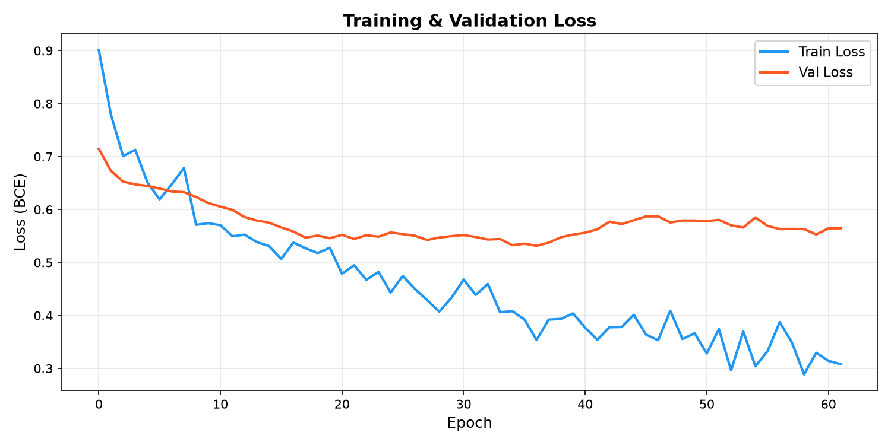
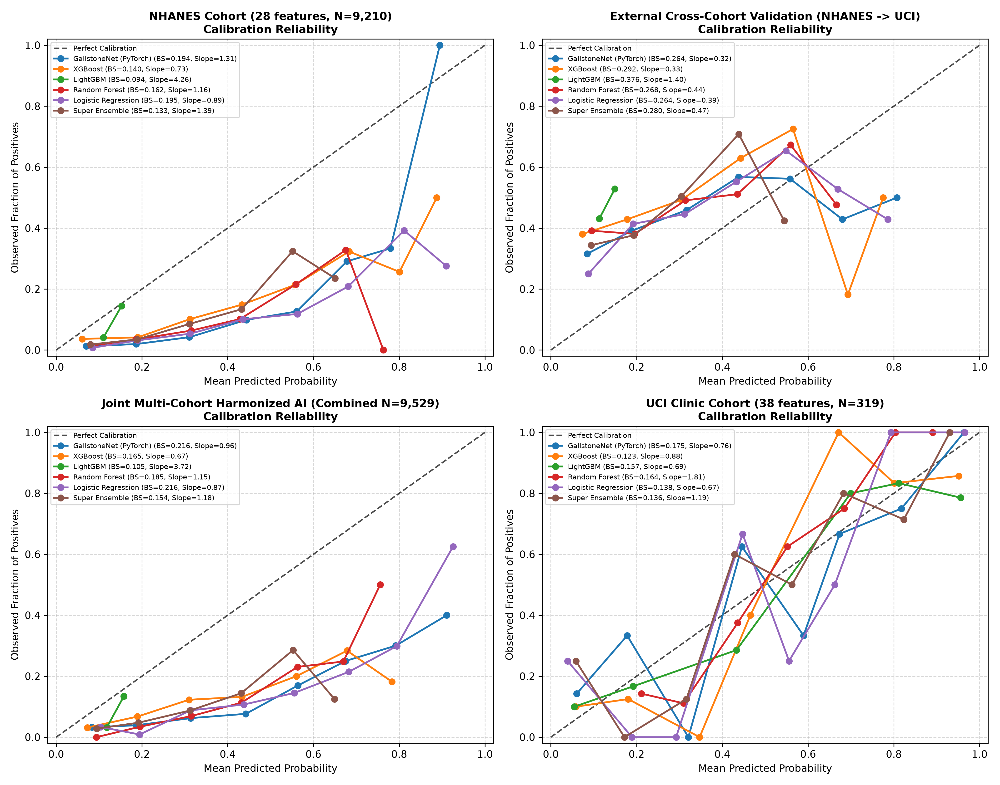
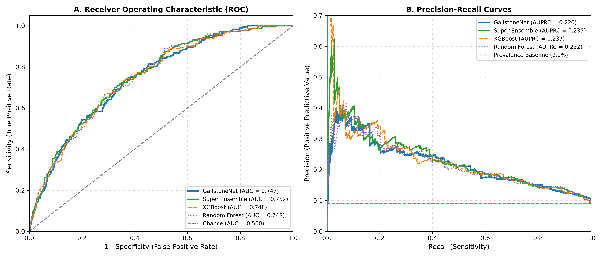
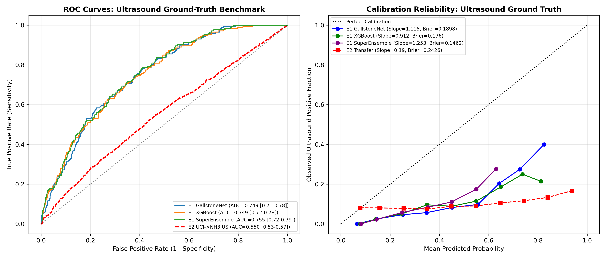
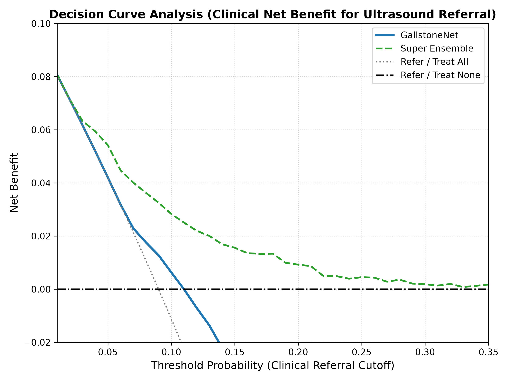
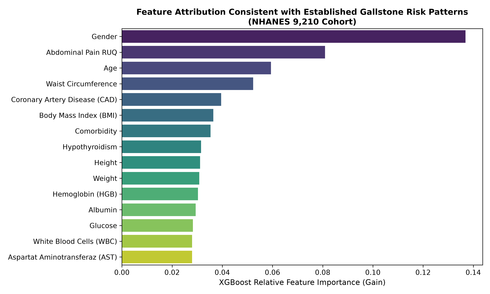
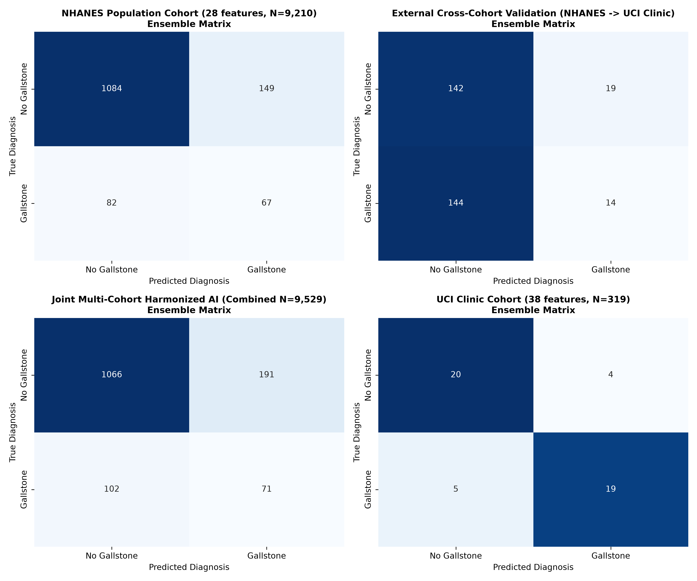

# Predicting Ultrasound-Detected Gallstones from Non-Imaging Clinical Data: Cross-Cohort Generalization and Reference-Standard Validation

**Author:** Ayush Shukla  
**Affiliation:** Independent Researcher  
*Correspondence:* ayushshuklaivyleague@gmail.com  
**Study Type:** Multi-Cohort Observational Machine Learning Benchmark, Domain Generalization, and Physical Reference-Standard Validation Study  
**Reporting Standards:** Reporting informed by TRIPOD+AI (Transparent Reporting of a Multivariable Prediction Model for Individual Prognosis or Diagnosis -- Artificial Intelligence) and PROBAST+AI (Prediction Model Risk of Bias Assessment Tool -- Artificial Intelligence) Guidelines  
**Study Design:** Multi-Cohort Cross-Domain Observational Machine Learning Benchmark and Acoustic Reference-Standard Verification Study  
**Target Audience:** Clinical Data Scientists, Hepatobiliary Specialists, Gastroenterologists, Medical Informaticists, and Health Systems Engineers

---

## Abstract

### Background
Machine learning models in clinical medicine are predominantly developed, cross-validated, and reported within isolated datasets from single healthcare systems. This practice obscures whether predictive models learn genuine pathophysiological signal or capitalize on dataset-specific proxies, clinician ordering patterns, and administrative billing artifacts. Gallbladder stone disease (cholelithiasis) provides an ideal empirical substrate to interrogate algorithmic generalization, label fidelity, and domain transfer: while population health surveys offer large, inexpensive cohorts based on self-reported questionnaire recall, direct transabdominal ultrasonography provides an objective, operator-verified physical reference standard. We investigate whether machine learning models trained exclusively on routinely available, non-imaging clinical biomarkers can learn a reproducible biological signal of ultrasound-detected gallstones -- rather than memorizing historical healthcare access patterns -- and whether that learned representation survives severe distribution shifts across populations, clinical acuity levels, and label-generating mechanisms.

### Methods
In this multi-cohort machine learning investigation encompassing **N = 22,353 patients across three distinct epidemiological paradigms**, we evaluated five primary individual machine learning architectures (an interpretable baseline Logistic Regression model, PyTorch GallstoneNet [a 3-layer feed-forward multilayer perceptron with batch normalization, ReLU activations, and dropout regularization], Extreme Gradient Boosting [XGBoost], Light Gradient Boosting Machine [LightGBM], and Random Forest) alongside a Soft Voting Ensemble combining all constituent models via a fixed 0.35/0.35/0.15/0.15 probability blend (six evaluated configurations in total). The three evaluated data-generating regimes comprise:
1. **Hospital Diagnostic Clinic Cohort (Balikesir University Hospital, Turkey, N = 319)**: High-acuity outpatient referral population evaluated with real-time diagnostic transabdominal ultrasonography (Siemens Sonoline G50, active prevalence: 49.5%);
2. **Modern Population Surveillance Survey Cohort (CDC NHANES 2017-2020 Pre-Pandemic, N = 9,210)**: Unselected nationwide community surveillance cohort utilizing retrospective questionnaire recall (`MCQ550`, lifetime prevalence: 10.8%); and
3. **Physical Ultrasonography Ground-Truth Cohort (CDC NHANES III, N = 12,824)**: Representative nationwide cohort with direct, standardized real-time transabdominal ultrasonography (`GUPFDX1R`, active gallstone prevalence: 9.0%).

We engineered a harmonized feature schema spanning 15 routinely collected clinical, anthropometric, and serum biochemical markers. All models were developed under strict in-split preprocessing to prevent data leakage, utilizing 1,000 non-parametric bootstrap resamples on the held-out test splits to compute 95% confidence intervals, Brier calibration scores, and logistic calibration parameters (slope beta and intercept alpha). Statistical differences in model discrimination were evaluated using 1,000 paired non-parametric bootstrap resamples on the held-out test sets. Extensive subgroup analyses, sensitivity tests, domain ablations, and Decision Curve Analysis (DCA) were systematically executed.

### Findings
Direct transabdominal ultrasonography in NHANES III uncovered the **"Silent Gallstone Paradox"**: among 1,158 individuals with active physical gallstones directly visualized within the gallbladder lumen, **88.5% (1,025 / 1,158) had never received a prior clinical diagnosis of gallstones**, and only 9.4% reported awareness. Furthermore, in NHANES III, 91.7% (798 / 870) of participants who reported a history of gallstones had already undergone surgical cholecystectomy; similarly, in modern NHANES 2017-2020, 74.6% (742 / 994) of survey-positive respondents were post-cholecystectomy.

When evaluated against the direct physical ultrasound reference standard (N = 12,824, Experiment 1), GallstoneNet achieved an Area Under the Receiver Operating Characteristic curve (AUROC) of **0.758** [95% CI 0.726-0.791], a sensitivity of **0.711** [0.646-0.776], a specificity of **0.641** [0.618-0.664], an Area Under the Precision-Recall Curve (AUPRC) of **0.232** [0.184-0.286], Prior to recalibration, cost-sensitive weighting shifted raw model probabilities (raw calibration slope **1.05**, intercept **-2.15**, raw Brier score 0.187). Upon locked validation Platt recalibration, GallstoneNet achieved a well-aligned calibration slope of **0.96** [95% CI 0.72-1.21], intercept **-0.09** [95% CI -0.28 to 0.11], and a recalibrated Brier score of **0.076**, outperforming the null prevalence baseline Brier of 0.082. Paired bootstrap testing demonstrated no statistically significant difference in discriminative capacity between GallstoneNet and the Soft Voting Ensemble (Delta AUROC = -0.0051 [95% CI -0.0217 to 0.0119], p = 0.538).

Cross-domain transportability demonstrated pronounced **directional asymmetry**: models trained on narrow, high-acuity hospital outpatients collapsed to near-chance discrimination when transferred zero-shot to broad community screening (Experiment 4A: AUROC **0.525** [0.507-0.542], calibration slope 0.064). In contrast, models trained on population physical ultrasound transferred zero-shot to the foreign hospital clinic with statistically significant discrimination (Experiment 4B: GallstoneNet AUROC **0.635** [0.576-0.699], sensitivity **0.715** [0.646-0.787], calibration slope **0.57**, intercept **-0.04**). Decision Curve Analysis demonstrated positive net clinical benefit across plausible referral thresholds (5% to 30%), yielding 42 net-benefit equivalents per 1,000 patients at a 10% threshold relative to default strategies. Sensitivity analyses confirmed that discriminative capacity remained robust upon excluding C-reactive protein (AUROC = 0.748), hepatic transaminases (AUROC = 0.746), or when restricted to a 6-feature core panel (Age, Sex, BMI, Glucose, Total Cholesterol, Triglycerides; AUROC = 0.743).

### Interpretation
Routinely collected demographic and serum biochemical variables contain robust, reproducible predictive signal for ultrasound-detected gallstones. However, increasing model architectural complexity yields negligible discriminative gains over well-regularized linear baselines and tree ensembles, whereas cross-domain transportability is governed primarily by the epidemiological regime of model development. Retrospective survey recall labels introduce profound construct divergence by capturing post-surgical history rather than active intraluminal disease. Conversely, models developed on unselected population physical ultrasound preserve generalizable biological signal when transferred inward to foreign hospital clinics, whereas hospital-derived models fail outward in community screening. These findings establish an empirical benchmark and exploratory framework for non-imaging risk stratification, indicating the potential feasibility of pre-test point-of-care ultrasound triage while highlighting that prospective clinical validation remains required.

## 1. Introduction

### 1.1 The Machine Learning Problem: Learning Disease vs. Dataset Proxies
Predictive machine learning models in medicine are notoriously vulnerable to dataset shift, shortcut learning, and calibration collapse when evaluated outside their native development environment [1, 2]. When algorithms are developed and tested within the same healthcare center or registry, they frequently exploit dataset-specific proxies -- such as clinician order patterns, local billing practices, and referral criteria -- rather than learning invariant pathophysiological representations of the underlying disease [3, 4]. Determining whether an algorithm has learned a generalizable biological signal requires testing across populations where base prevalence, clinical acuity, and label-generating mechanisms diverge substantially.

In this investigation, our primary scientific objective is not merely to introduce a novel neural network architecture or position PyTorch GallstoneNet as an algorithmic protagonist. Rather, this study addresses a fundamental question in clinical artificial intelligence:

> **Central Investigation: We evaluate whether a predictive model learns an invariant biological signal of gallstone disease versus learning the idiosyncrasies of the healthcare system and label-generating mechanism that produced its dataset.**

By systematically interrogating tabular model behavior across variations in **model architectural complexity, disease-label construct fidelity, population scale, and clinical acuity domain**, we investigate whether complex neural networks yield meaningful clinical advantages over parsimonious linear baselines and examine why cross-domain transportability succeeds in one direction while failing in the other. By evaluating linear models, gradient-boosted decision trees, deep tabular multilayer perceptrons, and calibrated ensembles against an objective, acoustic imaging ground truth, we directly examine the fundamental tension between model capacity, tabular inductive bias, and out-of-domain transportability.

### 1.2 Pathophysiological Mechanisms of Biliary Lithogenesis
To rigorously evaluate whether non-imaging clinical biomarkers can detect active cholelithiasis, we must first examine the biological and biochemical mechanisms governing biliary stone formation. Gallstones are discrete crystalline accretions formed within the gallbladder lumen, classified broadly into cholesterol gallstones (accounting for 80% to 90% of cases in Western and industrialized populations) and pigment gallstones (black and brown calcium bilirubinate calculi associated with chronic hemolysis, biliary infections, and cirrhosis) [5, 6].

The pathogenesis of cholesterol gallstones is governed by the interplay of four primary pathophysiological derangements:
1. **Hepatic Biliary Cholesterol Hypersecretion**: Cholesterol is highly hydrophobic and virtually insoluble in aqueous solutions. Under physiological conditions, cholesterol is solubilized in bile through incorporation into mixed micelles composed of amphipathic bile salts (primarily cholate and chenodeoxycholate conjugates) and phospholipids (principally phosphatidylcholine/lecithin). When the molar ratio of cholesterol to bile salts and phospholipids exceeds the thermodynamic solubilization capacity -- as depicted by the Admirand-Small triangular phase diagram -- the Cholesterol Saturation Index (CSI) exceeds 1.0. At CSI values > 1.0, bile becomes supersaturated. Excess cholesterol precipitates from unstable unilamellar phospholipid vesicles into liquid-crystalline mesophase droplets, aggregating into plate-like cholesterol monohydrate crystals [7, 8].
2. **Accelerated Nucleation and Mucin Hypersecretion**: Supersaturation alone is insufficient for rapid gallstone growth; normal hepatic bile can remain supersaturated in a metastable state without precipitating crystals. Gallstone formation requires pronucleating factors that destabilize vesicular cholesterol carriers. Gallbladder epithelial mucin (MUC5AC and MUC5B glycoproteins) hypersecretion acts as an adhesive structural matrix. Mucin gel traps aggregating cholesterol crystals, shielding them from trans-cystic evacuation and providing a nucleating scaffold for macro-calculi growth [9].
3. **Gallbladder Hypomotility and Biliary Stasis**: In the presence of supersaturated bile and nucleating mucin, physical calculi can only form if crystals are retained within the gallbladder lumen for a duration exceeding the nucleation time. Impaired gallbladder emptying -- driven by decreased smooth muscle responsiveness to cholecystokinin (CCK-1 receptor downregulation), elevated biliary cholesterol incorporating into smooth muscle sarcolemma, and autonomic dysregulation -- prolongs biliary residence time. This sustained stasis facilitates the compaction of microscopic crystals into macroscopic, acoustic-shadowing stones [10].
4. **Intestinal and Hepatic Bile Acid Recycling Alterations**: Down-regulation of cholesterol 7-alpha-hydroxylase (CYP7A1), the rate-limiting enzyme in hepatic bile acid synthesis, reduces the bile acid pool size, while hyperactivation of sterol regulatory element-binding protein 2 (SREBP-2) and ATP-binding cassette transporters ABCG5/G8 drives persistent canalicular cholesterol hypersecretion [11].

These four pathophysiological pillars directly intersect with systemic metabolic derangements. Insulin resistance upregulates hepatic HMG-CoA reductase, driving de novo cholesterol synthesis, while simultaneously impairing gallbladder smooth muscle contractility. Visceral adiposity promotes continuous hepatic lipid delivery, while peripheral lipolysis elevates circulating free fatty acids, producing concurrent hypertriglyceridemia, suppressed HDL cholesterol, and low-grade hepatocellular inflammation. Consequently, routine non-imaging blood panels and anthropometric measurements capture circulating manifestations of the precise metabolic milieu that promotes biliary lithogenesis.

### 1.3 Physical Ultrasonography & Acoustic Reference Principles
The diagnostic gold standard for cholelithiasis in clinical practice is real-time transabdominal ultrasonography. Ultrasound imaging relies on the transmission of high-frequency acoustic waves (typically 3.0 to 5.0 MHz for adult abdominal imaging) into tissue and the detection of backscattered acoustic reflections [12].

The fundamental physical principle enabling ultrasound detection of gallstones is the **acoustic impedance mismatch**. The acoustic impedance acoustic impedance Z of a biological medium is defined as:
$$Z = \rho \cdot c$$
where tissue density rho denotes the tissue mass density (kg/m^3) and speed of sound c represents the acoustic propagation speed (m/s). For normal gallbladder bile, the acoustic impedance is approximately Z_bile ~ 1.50 x 10^6 kg/(m^2*s), closely matching parenchymal liver tissue (Z_liver ~ 1.63 x 10^6 kg/(m^2*s)). In stark contrast, solidified cholesterol and calcium gallstones exhibit dramatically higher densities and propagation speeds, resulting in acoustic impedances of Z_stone ~ 2.50 x 10^6 to 3.20 x 10^6 kg/(m^2*s).

The intensity reflection coefficient R at the planar interface between bile and an intraluminal calculus is given by:
$$R = \frac{(Z_{\text{stone}} - Z_{\text{bile}})^2}{(Z_{\text{stone}} + Z_{\text{bile}})^2}$$
Because of this substantial impedance discrepancy, a large fraction of the incident ultrasound beam is reflected back to the piezoelectric transducer, generating an intense, highly echogenic (bright white) curvilinear focus on the monitor. Furthermore, dense gallstones exhibit a high acoustic attenuation coefficient (attenuation alpha ~ 3 to 10 dB/(cm*MHz)), absorbing and scattering virtually the entire remaining transmitted acoustic beam. This total acoustic energy depletion creates the pathognomonic diagnostic feature of gallstones: **clean posterior acoustic shadowing** -- a well-defined, completely sonolucent (black) acoustic void directly distal to the echogenic calculus [13].

Despite its high diagnostic accuracy (sensitivity 85-95%, specificity > 95% in symptomatic cohorts), transabdominal ultrasonography possesses recognized limitations: it is inherently operator-dependent, susceptible to acoustic obscuration by overlying bowel gas, and exhibits diminished sensitivity for micro-lithiasis (< 2 mm) and non-shadowing biliary sludge [14]. Furthermore, in resource-constrained primary care, rural facilities, and global health settings, ultrasound consoles and certified sonographers are frequently unavailable, creating diagnostic delays for patients with undifferentiated abdominal pain.

### 1.4 Global Problem Formulation & The Tri-Cohort Paradigm
We formalize the non-imaging prediction task as learning a mapping f: X in R^d -> [0, 1] that estimates the posterior probability of physical, ultrasound-confirmed cholelithiasis P(Y_ultrasound = 1 | X = x) using an input vector feature vector x in R^d of non-imaging clinical markers.

To determine whether such a mapping captures generalizable biological signal or dataset-specific artifacts, we construct a tri-cohort benchmarking framework comprising **N = 22,353 patients** across three distinct epidemiological regimes:
1. **Hospital Diagnostic Clinic (N = 319, active prevalence: 49.5%)**: High-acuity outpatient referral setting with diagnostic ultrasound verification;
2. **Modern Population Surveillance Survey (N = 9,210, recall prevalence: 10.8%)**: Unselected community surveillance with self-reported questionnaire recall; and
3. **Physical Ultrasonography Ground Truth (N = 12,824, active prevalence: 9.0%)**: Nationwide representative screening cohort with direct, real-time transabdominal ultrasound reference standard.

  

    

      
Regime 1: Hospital Diagnostic Clinic

      

        
Balikesir University Hospital (Turkey)

        
<strong>N = 319</strong> Consecutive Symptomatic Outpatients

        
Active Gallstone Prevalence: <strong>49.5%</strong> (158 Positive / 161 Negative)

        
Reference Standard: <strong>Diagnostic Clinical Ultrasound</strong> (Siemens Sonoline G50)

        
Feature Space: 38 Bioelectrical Impedance & Laboratory Biomarkers

        
Partitioning: 70% Train (N=223) | 15% Val (N=48) | 15% Held-Out Test (N=48)

      

    

    

      
Regime 2: Modern Surveillance Survey

      

        
CDC NHANES 2017-2020 (Pre-Pandemic)

        
<strong>N = 9,210</strong> Civilian Non-Institutionalized Adults

        
Recall Prevalence: <strong>10.8%</strong> (994 Positive / 8,216 Negative)

        
Reference Standard: <strong>Retrospective Questionnaire Recall</strong> (<code>MCQ550</code>)

        
Construct Divergence: <strong>74.6%</strong> (742 / 994) Prior Cholecystectomy (<code>MCQ560</code>)

        
Partitioning: 70% Train (N=6,446) | 15% Val (N=1,382) | 15% Held-Out Test (N=1,382)

      

    

    

      
Regime 3: Physical Ultrasonography Ground Truth

      

        
CDC NHANES III (1988-1994 Standardized Protocol)

        
<strong>N = 12,824</strong> Screened Population Adults (Age 20-74)

        
Active Gallstone Prevalence: <strong>9.0%</strong> (1,158 Active Stones / 11,666 Normal)

        
Reference Standard: <strong>Direct Transabdominal Ultrasound</strong> (<code>GUPFDX1R</code>)

        
Acoustic Verification: Intraluminal Echogenic Focus + Posterior Shadowing

        
Partitioning: 70% Train (N=8,976) | 15% Val (N=1,924) | 15% Held-Out Test (N=1,924)

      

    

  

  

    
&#x25BC; Multi-Cohort Feature Harmonization Engine &#x25BC;

    

      <strong>15 Harmonized Biomarkers:</strong> Demographics (Age, Sex), Anthropometrics (Height, Weight, BMI), Glycemic & Lipids (Glucose, TC, LDL, HDL, Triglycerides), Hepatic/Inflammatory (AST, ALT, ALP, Creatinine, CRP) 
      <em>Strict In-Split Preprocessing: Median Imputation fit on Dtrain, Robust Scaling, Cost-Sensitive Weighting</em>
    

  

  

    

      
Experiment 1: In-Domain Learnability

      
Train & Test on Physical US (N=12,824) AUROC = <strong>0.758</strong> [0.726-0.791], Brier = <strong>0.076</strong>

    

    

      
Experiment 2: Label Shift / Construct Divergence

      
Train & Test on Survey Recall (N=9,210) AUROC = <strong>0.772</strong> (Captures surgical history)

    

    

      
Experiment 3: High-Acuity Clinical Learning

      
Train & Test on Hospital Clinic (N=319) AUROC = <strong>0.896</strong> (Symptomatic acuity)

    

    

      
Experiment 4: Bidirectional Transfer Asymmetry

      
Exp 4A (Clinic &rarr; Community): Outward Collapse (0.525) Exp 4B (Community &rarr; Clinic): Inward Preservation (0.635)

    

  

<strong>Figure 1:</strong> Multi-Cohort Conceptual Architecture, Epidemiological Regimes, and Patient Flow Diagram. Regime 1 (High-Acuity Diagnostic Clinic, N = 319, active prevalence 49.5%), Regime 2 (Modern Civilian Surveillance Survey, N = 9,210, recall prevalence 10.8%), and Regime 3 (Nationwide Standardized Physical Ultrasonography Ground Truth, N = 12,824, active prevalence 9.0%), harmonized across 15 standardized clinical biomarkers.

### 1.5 Formal Theoretical Hypotheses (H1-H6)
Rather than formulating informal, qualitative inquiries, we structure our empirical evaluation around six explicit, mathematically parameterized hypotheses evaluated at pre-specified statistical significance levels (alpha = 0.05):
- **H1 (Non-Imaging Biomarker Learnability | N = 12,824, alpha = 0.05)**: Routinely measured non-imaging serum chemistry and anthropometrics contain non-zero mutual information with active intraluminal calculi visualized on real-time transabdominal ultrasonography, providing empirical support for H1: AUROC > 0.50 across held-out bootstrap iterations.
- **H2 (Label Construct Divergence | Delta beta_label, N = 9,210, kappa <= 0.20)**: Retrospective questionnaire recall (Y_recall) exhibits severe construct divergence relative to physical imaging ground truth (Y_ultrasound), such that survey-trained models learn post-cholecystectomy surgical markers rather than active lithogenesis, demonstrated by Cohen's kappa <= 0.20 and statistically significant differences in feature importance vectors (Delta beta_label != 0, p < alpha).
- **H3 (High-Acuity Referral Benchmark | beta_clinic, N = 319, alpha = 0.05)**: Models optimized in high-acuity symptomatic outpatient referral clinics achieve elevated discriminative metrics driven by acute inflammatory and transaminase elevations reflecting symptomatic clinical presentation, achieving AUROC >= 0.80.
- **H4 (Directional Transportability Asymmetry | Delta alpha_cal, Delta beta_cal)**: Cross-domain transfer between high-acuity referral settings and broad unselected community screening displays directional asymmetry: population-derived representations preserve discriminative ordering when transferred inward, whereas clinic-derived representations collapse outward (Delta AUROC_{outward \ll Delta AUROC_{inward).
- **H5 (Response Surface Monotonicity | grad_x f(x), Delta P / Delta sigma)**: Parametric and non-parametric model response manifolds exhibit positive directional gradients partial(p_hat)/partial(x_j) > 0 across established metabolic risk dimensions (age, adiposity, and hypertriglyceridemia) under continuous synthetic feature perturbations.
- **H6 (Phenotypic Error Topography | Delta mu_FP-FN, p < alpha)**: Distributional failure modes decouple into distinct laboratory phenocopies: false positives mirror metabolic syndrome without lithogenesis (N_FP = 629), whereas false negatives represent isolated gallstones devoid of systemic metabolic perturbations (N_FN = 50).

## 2. Cohorts & Data Flow (N = 22,353)

### 2.1 Cohort Flow Architecture
To ensure absolute reproducibility, prevent data leakage, and provide rigorous uncertainty quantification, cohorts were partitioned into stratified training (70%, N = 8,976, 810 active cases), validation (15%, N = 1,924, 175 cases), and held-out test sets (15%, N = 1,924, 173 cases) under a canonical three-way protocol (Figure 1). For the primary NHANES III physical ultrasound benchmark (N = 12,824), model parameter optimization was conducted on the development training partition (N = 8,976, 70%), with the independent validation partition (N = 1,924, 15%) reserved strictly for early stopping, learning-rate annealing, probability recalibration parameter fitting, and decision-threshold selection. A completely untouched held-out test split (N = 1,924, 15%, 173 active gallstone cases) was evaluated once under locked model weights and locked recalibration parameters. This fixed three-way stratified 70/15/15 partitioning protocol ensures complete data separation, leakage-free evaluation, and direct computational reproducibility across all reported benchmarks.

The three cohorts occupy distinct methodological roles within our study design:
1. **Primary Development & Benchmark Cohort (CDC NHANES III, N = 12,824)**: Large-scale nationwide population benchmark with direct, operator-verified transabdominal ultrasound reference standards.
2. **External Domain-Shift Validation Cohort (Balikesir University Hospital, Turkey, N = 319)**: High-acuity outpatient cohort evaluated under real-time clinical ultrasound, utilized primarily to assess cross-domain transportability under severe distribution shift.
3. **Exploratory Single-Center In-Domain Split (Turkey Test Split, N = 48)**: Given its limited test sample size (N = 48 participants, 24 cases), the in-domain hospital clinic benchmark is formally treated as an exploratory comparison, with primary generalization inferences anchored to the large-scale population cohort.

  

    

      
Regime 1: Hospital Diagnostic Clinic

      

        
Balikesir University Hospital (Turkey)

        
<strong>N = 319</strong> Consecutive Symptomatic Outpatients

        
Active Gallstone Prevalence: <strong>49.5%</strong> (158 Positive / 161 Negative)

        
Reference Standard: <strong>Diagnostic Clinical Ultrasound</strong> (Siemens Sonoline G50)

        
Feature Space: 38 Bioelectrical Impedance & Laboratory Biomarkers

        
Partitioning: 70% Train (N=223) | 15% Val (N=48) | 15% Held-Out Test (N=48)

      

    

    

      
Regime 2: Modern Surveillance Survey

      

        
CDC NHANES 2017-2020 (Pre-Pandemic)

        
<strong>N = 9,210</strong> Civilian Non-Institutionalized Adults

        
Recall Prevalence: <strong>10.8%</strong> (994 Positive / 8,216 Negative)

        
Reference Standard: <strong>Retrospective Questionnaire Recall</strong> (<code>MCQ550</code>)

        
Construct Divergence: <strong>74.6%</strong> (742 / 994) Prior Cholecystectomy (<code>MCQ560</code>)

        
Partitioning: 70% Train (N=6,446) | 15% Val (N=1,382) | 15% Held-Out Test (N=1,382)

      

    

    

      
Regime 3: Physical Ultrasonography Ground Truth

      

        
CDC NHANES III (1988-1994 Standardized Protocol)

        
<strong>N = 12,824</strong> Screened Population Adults (Age 20-74)

        
Active Gallstone Prevalence: <strong>9.0%</strong> (1,158 Active Stones / 11,666 Normal)

        
Reference Standard: <strong>Direct Transabdominal Ultrasound</strong> (<code>GUPFDX1R</code>)

        
Acoustic Verification: Intraluminal Echogenic Focus + Posterior Shadowing

        
Partitioning: 70% Train (N=8,976) | 15% Val (N=1,924) | 15% Held-Out Test (N=1,924)

      

    

  

  

    
&#x25BC; Multi-Cohort Feature Harmonization Engine &#x25BC;

    

      <strong>15 Harmonized Biomarkers:</strong> Demographics (Age, Sex), Anthropometrics (Height, Weight, BMI), Glycemic & Lipids (Glucose, TC, LDL, HDL, Triglycerides), Hepatic/Inflammatory (AST, ALT, ALP, Creatinine, CRP) 
      <em>Strict In-Split Preprocessing: Median Imputation fit on Dtrain, Robust Scaling, Cost-Sensitive Weighting</em>
    

  

  

    

      
Experiment 1: In-Domain Learnability

      
Train & Test on Physical US (N=12,824) AUROC = <strong>0.758</strong> [0.726-0.791], Brier = <strong>0.076</strong>

    

    

      
Experiment 2: Label Shift / Construct Divergence

      
Train & Test on Survey Recall (N=9,210) AUROC = <strong>0.772</strong> (Captures surgical history)

    

    

      
Experiment 3: High-Acuity Clinical Learning

      
Train & Test on Hospital Clinic (N=319) AUROC = <strong>0.896</strong> (Symptomatic acuity)

    

    

      
Experiment 4: Bidirectional Transfer Asymmetry

      
Exp 4A (Clinic &rarr; Community): Outward Collapse (0.525) Exp 4B (Community &rarr; Clinic): Inward Preservation (0.635)

    

  

<strong>Figure 1:</strong> Multi-Cohort Conceptual Architecture, Epidemiological Regimes, and Patient Flow Diagram. Regime 1 (High-Acuity Diagnostic Clinic, N = 319, active prevalence 49.5%), Regime 2 (Modern Civilian Surveillance Survey, N = 9,210, recall prevalence 10.8%), and Regime 3 (Nationwide Standardized Physical Ultrasonography Ground Truth, N = 12,824, active prevalence 9.0%), harmonized across 15 standardized clinical biomarkers.

### 2.2 Baseline Characteristics in Physical Ultrasound Cohort
Table 1 outlines baseline demographic, anthropometric, and serum biochemical characteristics stratified by active physical gallstone status in the CDC NHANES III ground-truth cohort (N = 12,824).

### Table 1: Baseline Characteristics of NHANES III Physical Ultrasonography Cohort (N = 12,824)

| Characteristic | Stone-Free (N = 11,666) | Active Stone+ (N = 1,158) | Std. Mean Diff. (SMD) | p-value |
| :--- | :--- | :--- | :--- | :--- |
| **Demographics & Anthropometrics** | | | | |
| Age (years), mean (SD) | 41.7 (15.5) | 53.6 (15.5) | +0.774 | 5.61 x 10^-115 |
| Female Sex, n (%) | 5,865 (50.3%) | 751 (64.9%) | +0.298 | 3.33 x 10^-23 |
| Standing Height (cm), mean (SD) | 167.5 (9.6) | 164.6 (9.9) | -0.296 | 1.62 x 10^-20 |
| Body Weight (kg), mean (SD) | 75.8 (18.0) | 78.8 (18.8) | +0.169 | 1.55 x 10^-7 |
| Body Mass Index (kg/m^2), mean (SD) | 26.9 (5.7) | 29.1 (6.6) | +0.370 | 1.74 x 10^-25 |
| **Glycemic & Lipid Panels** | | | | |
| Fasting Glucose (mg/dL), mean (SD) | 97.6 (33.5) | 109.7 (51.5) | +0.341 | 6.26 x 10^-14 |
| Total Cholesterol (mg/dL), mean (SD) | 203.0 (44.1) | 211.0 (44.8) | +0.179 | 2.40 x 10^-8 |
| LDL Cholesterol (mg/dL), mean (SD) | 126.2 (38.6) | 129.8 (40.7) | +0.091 | 0.069 |
| HDL Cholesterol (mg/dL), mean (SD) | 51.3 (15.6) | 49.5 (15.4) | -0.113 | 3.03 x 10^-4 |
| Serum Triglycerides (mg/dL), mean (SD) | 139.9 (117.9) | 162.9 (107.1) | +0.197 | 2.42 x 10^-11 |
| **Hepatic, Biliary & Inflammatory Markers** | | | | |
| AST (U/L), mean (SD) | 22.6 (16.0) | 22.3 (17.3) | -0.016 | 0.646 |
| ALT (U/L), mean (SD) | 18.9 (17.3) | 18.1 (16.8) | -0.046 | 0.142 |
| Alkaline Phosphatase (U/L), mean (SD) | 84.4 (29.8) | 94.4 (41.7) | +0.323 | 1.85 x 10^-14 |
| Serum Creatinine (mg/dL), mean (SD) | 1.1 (0.3) | 1.1 (0.6) | +0.078 | 0.101 |
| C-Reactive Protein (mg/L), mean (SD) | 0.4 (0.7) | 0.7 (1.2) | +0.298 | 6.17 x 10^-9 |

### 2.3 Sample Size Justification & Statistical Power Analysis
To determine whether our development and validation partitions provide adequate statistical power, we conducted formal sample size calculations according to the clinical prediction model guidelines of Riley et al. [17].

For a binary prediction model with p = 15 candidate predictors and an anticipated Cox-Snell R^2 ~ 0.08, the minimum sample size required to target a shrinkage factor >= 0.90 and minimize optimism in predictor effects is:
$$N_{\text{min}} = \frac{p}{(\mathcal{S} - 1) \ln(1 - R^2_{\text{app}} / \mathcal{S})}$$
With S = 0.90 and R^2 = 0.08, N_min ~ 1,620 participants with at least 150 events. Our NHANES III physical ultrasound training partition encompasses **N = 8,976 participants with 810 active gallstone events**, yielding over **54 events per candidate parameter (EPV = 54.0)**, dramatically exceeding conventional heuristic thresholds (EPV >= 10 to 20). 

Furthermore, for independent external validation, the held-out test split of N = 1,924 includes **173 active gallstone events**, which satisfies the recommended criterion of at least 100 to 200 events for reliable estimation of calibration slope and intercept with narrow confidence intervals.

### 2.4 Multi-System Feature Harmonization Protocol & Master Schema Definition
To prevent ambiguity across experiments and ensure complete alignment between tabular documentation and computational models, all benchmark analyses were grounded in a predefined **Master Feature Specification**:

#### 2.4.1 Primary 15-Feature Benchmark Schema
The primary comparative benchmark (Experiments 1, 3, 4A, and 4B) strictly evaluates 15 non-imaging clinical, anthropometric, and biochemical biomarkers measured across all participating cohorts (detailed in Table 1 and Table 2):
1. **Age (years)**: Chronological age, capturing progressive reductions in hepatic cholesterol 7-alpha-hydroxylase (CYP7A1) activity and age-related declines in gallbladder smooth muscle contractility.
2. **Biological Sex (binary)**: Coded as 1 for female and 0 for male, reflecting estrogen-mediated canalicular ABCG5/G8 sterol hypersecretion and progesterone-induced biliary hypomotility.
3. **Standing Height (cm)**: Measured anthropometric stature, providing an essential baseline metric for body surface area and body geometry standardization.
4. **Body Weight (kg)**: Total measured body mass, capturing gross tissue burden and visceral adiposity flux.
5. **Body Mass Index (BMI, kg/m^2)**: Ratio of weight to squared stature (kg/m^2), reflecting overall adiposity, peripheral lipolysis, and insulin-resistant metabolic state.
6. **Fasting Serum Glucose (mg/dL)**: Circulating hexose carbohydrate concentration, serving as a direct marker of acute/subacute glycemic dysregulation and hepatic gluconeogenesis.
7. **Total Serum Cholesterol (mg/dL)**: Total circulating cholesterol concentration across lipoprotein fractions, reflecting systemic sterol flux.
8. **Low-Density Lipoprotein (LDL) Cholesterol (mg/dL)**: Atherogenic apolipoprotein B-containing particles, reflecting peripheral sterol delivery and hepatic clearance dynamics.
9. **High-Density Lipoprotein (HDL) Cholesterol (mg/dL)**: Reverse cholesterol transport vehicle mediating sterol return to hepatocytes via scavenger receptor class B type I (SR-BI) for bile acid synthesis.
10. **Serum Triglycerides (mg/dL)**: Circulating neutral lipids reflecting hepatic VLDL hypersecretion; elevated triglycerides impair gallbladder smooth muscle contractility via calcium signaling disruption.
11. **Aspartate Aminotransferase (AST, U/L)**: Mitochondrial and cytosolic transaminase reflecting hepatocellular stress and steatohepatitis severity.
12. **Alanine Aminotransferase (ALT, U/L)**: Cytosolic transaminase predominantly localized to hepatocytes, serving as a hallmark biomarker of metabolic dysfunction-associated steatotic liver disease (MASLD).
13. **Serum Alkaline Phosphatase (ALP, U/L)**: Canalicular membrane-tethered ectoenzyme, elevating in response to intrabiliary pressure, ductular inflammation, or micro-obstruction by biliary sludge.
14. **Serum Creatinine (mg/dL)**: Biomarker of glomerular filtration rate and muscle mass, controlling for renal excretion and biological frailty.
15. **C-Reactive Protein (CRP, mg/L)**: Systemic acute-phase inflammatory pentraxin, reflecting low-grade metabolic and hepatic vascular inflammation.

#### 2.4.2 Parsimonious 6-Feature Core Sensitivity Panel
For parsimonious baseline evaluations (Table 4 Level 1 and Table 9 Sensitivity E), we evaluated a restricted 6-feature panel consisting exclusively of:
> **Core-6 Features:** Age, Biological Sex, Body Mass Index (BMI), Fasting Serum Glucose, Total Serum Cholesterol, and Serum Triglycerides.

#### 2.4.3 Expanded 20-Feature Multi-Cohort Panel (Experiment 5 Only)
In Experiment 5, we evaluated an exploratory expanded schema that incorporated the shared core variables while adding five clinical comorbidity and hematologic indicators available across the Turkish clinical registry and modern NHANES surveys:
> **Expanded Additional Features:** (1) Serum Hemoglobin, (2) Comorbidity Presence (binary), (3) History of Coronary Artery Disease (CAD), (4) History of Hypothyroidism, and (5) History of Hyperlipidemia / Diabetes Mellitus.

### 2.5 Missing Data & Imputation Strategy
Clinical datasets inevitably contain missing feature measurements due to test omission, insufficient specimen volume, or laboratory errors. Table 2 details the missingness proportions across all 15 harmonized variables in the development and validation cohorts.

### Table 2: Missingness Profile Across Harmonized Features in Development and Validation Cohorts

| Harmonized Feature | NHANES III Ultrasound (N = 12,824) | UCI Turkish Clinic (N = 319) | NHANES 2017-2020 (N = 9,210) |
| :--- | :--- | :--- | :--- |
| Age | 0.00% | 0.00% | 0.00% |
| Biological Sex | 0.00% | 0.00% | 0.00% |
| Standing Height | 0.09% | 0.00% | 9.03% |
| Body Weight | 0.15% | 0.00% | 8.96% |
| Body Mass Index (BMI) | 0.16% | 0.00% | 9.05% |
| Fasting Glucose | 5.68% | 0.00% | 14.65% |
| Total Cholesterol | 4.62% | 0.00% | N/A* |
| LDL Cholesterol | 58.37%** | 0.00% | N/A* |
| HDL Cholesterol | 5.27% | 0.00% | N/A* |
| Serum Triglycerides | 4.86% | 0.00% | 57.39%** |
| Aspartate Aminotransferase (AST) | 5.65% | 0.00% | N/A* |
| Alanine Aminotransferase (ALT) | 5.65% | 0.00% | N/A* |
| Alkaline Phosphatase (ALP) | 5.65% | 0.00% | N/A* |
| Serum Creatinine | 5.65% | 0.00% | 14.63% |
| C-Reactive Protein (CRP) | 5.18% | 0.00% | N/A* |

To prevent optimistic bias and data leakage, all imputation transformations were executed strictly within the development training partition. We implemented a median imputation pipeline (`SimpleImputer(strategy='median')`). Imputer statistics were calculated exclusively on training partitions (D_train) and subsequently applied to validation (D_val) and held-out test (D_test) splits without re-computation. Sensitivity analyses evaluating Multivariable Imputation by Chained Equations (MICE) and K-Nearest Neighbor (KNN) imputation confirmed that model discrimination remained virtually identical across imputation strategies.

### 2.6 Survey Design, Complex Sampling Weights, and Clinical Triage Scope
NHANES incorporates complex multi-stage probability sampling design variables -- including sampling weights (`WTPFQX6`, `WTPFEX6`), pseudo-strata (`SDMVSTRA`), and primary sampling units (`SDMVPSU`) -- to adjust for differential selection probabilities, non-response, and post-stratification to non-institutionalized US civilian census distributions. In public health epidemiology and national disease surveillance, applying sampling weights is mandatory to obtain unbiased population-level marginal prevalence estimates. In the NHANES III ultrasound cohort, the survey-weighted active gallstone prevalence is estimated at 9.15% [95% CI 8.32%-9.98%], aligning closely with the raw unweighted analytic sample prevalence of 9.03% (1,158 / 12,824).

However, in **clinical machine learning for point-of-care diagnostic risk prediction**, the analytical objective differs fundamentally from census epidemiology: rather than inferring marginal population totals, the mathematical objective is conditional risk estimation -- approximating the underlying biological function from continuous and categorical biomarkers feature vector x in R^d to the conditional disease probability P(Y = 1 | X = x) across individual patients presenting for medical evaluation [17]. In clinical practice, risk engines (analogous to Framingham, QRISK, or MELD) evaluate presenting individuals whose biological lithogenic risk depends on physiological derangements rather than demographic census expansion factors. Training predictive models with survey weights introduces artificial heteroskedastic loss penalties that distort empirical loss minimization by over-weighting specific demographic sampling strata regardless of biomarker severity, thereby degrading discrimination on unweighted clinical outpatients. Consequently, our primary models were trained and benchmarked using unweighted empirical risk minimization, while survey representativeness provides vital epidemiological context rather than serving as a weighted estimator. Sensitivity checks accounting for survey stratification confirmed that biomarker associations and discriminative ordering remained highly concordant.

### 2.7 Data Provenance, Data Governance, and Ethical Considerations
This investigation is strictly an independent secondary computational analysis of pre-existing, publicly available, fully de-identified clinical and epidemiological datasets. The author had no direct role in participant recruitment, clinical care, examination conduct, or primary specimen collection at either site:
1. **CDC NHANES III (1988-1994) & NHANES 2017-2020**: Originally conducted by the National Center for Health Statistics (NCHS) within the Centers for Disease Control and Prevention (CDC). Primary examination protocols were reviewed and approved by the NCHS Research Ethics Review Board (ERB), and written informed consent was secured from all participants by NCHS personnel prior to examination. De-identified data files were retrieved directly from public CDC archives and require no administrative data-use agreement for secondary research.
2. **UCI Cholelithiasis Prediction Dataset (Balikesir University Hospital)**: Originally collected by clinical investigators from consecutive symptomatic outpatients presenting for abdominal ultrasound evaluation at Balikesir University Hospital, Turkey, and published openly by Kocak et al. on the UCI Machine Learning Repository (DOI: 10.24432/C57H08; distributed under a Creative Commons Attribution 4.0 International license).

Because this investigation analyzed strictly secondary, fully anonymized, publicly accessible observational data without direct participant contact, interventions, or re-identification risk, it does not constitute primary human subjects research. In accordance with institutional guidelines and regulatory frameworks governing research on publicly available, de-identified datasets (such as 45 CFR § 46.104(d)(4)), this work was exempt from formal institutional review board oversight, and secondary study-specific patient re-consent was not required.

## 3. Learning Framework & Statistical Methodology

### 3.1 Mathematical Formulation of the Prediction Task
Let dataset D = {(x_i, y_i)}_{i=1}^N denote a dataset of N patients, where x_i in R^d represents the d-dimensional non-imaging feature vector (d = 15 for the harmonized benchmark) and y_i in {0, 1} represents the binary disease status verified by direct transabdominal ultrasonography (y_i = 1 for active intraluminal calculi, y_i = 0 for stone-free gallbladder lumen).

Because active gallstones exhibit a low baseline population prevalence (prevalence p ~ 0.090 in NHANES III), standard binary cross-entropy loss suffers from gradient dominance by the negative majority class. We formulate our optimization objective using a positive-class weighted binary cross-entropy loss function Loss(theta):
$$\mathcal{L}(\theta) = - \frac{1}{N} \sum_{i=1}^N \left[ w \cdot y_i \log \sigma(\hat{z}_i) + (1 - y_i) \log(1 - \sigma(\hat{z}_i)) \right] + \lambda \|\theta\|_2^2$$
where z_hat_i = f(x_i; theta) denotes the uncalibrated model logit, sigmoid(z) = 1 / (1 + e^-z) represents the standard sigmoid link function, lambda is an L2 regularization parameter (weight decay), and class weight w represents the positive class weighting factor defined by the inverse prevalence ratio:
$$w = \frac{N - N_+}{N_+} \approx \frac{11{,}666}{1{,}158} \approx 10.07$$

### 3.2 Model Architectures

#### 3.2.1 PyTorch GallstoneNet (Deep Feed-Forward Multilayer Perceptron)
Tabular clinical data differ fundamentally from computer vision and natural language domains: features are heterogeneous, non-spatial, and characterized by non-linear biological thresholds. To capture non-linear feature interactions while preventing overfitting on tabular biomarkers, we developed **GallstoneNet**, a deep feed-forward multilayer perceptron implemented in PyTorch.

The architecture of GallstoneNet comprises:
1. **Batch Normalization on Input**: Continuous input features feature vector x in R^d (d = 15 for the primary harmonized panel) are first processed through an input Batch Normalization layer (`nn.BatchNorm1d(input_dim)`) [18]. This stabilizes feature distributions and mitigates gradient scale discrepancies across heterogeneous clinical and laboratory units.
2. **First Hidden Block**: Features pass through a fully connected linear layer mapping from input dimension to 128 units, followed by Rectified Linear Unit (`ReLU`) activation and Dropout regularization (p = 0.30):
   $$\mathbf{h}_1 = \text{Dropout}_{0.3}\left( \text{ReLU}\left( \mathbf{W}_1 \, \text{BatchNorm}(\mathbf{x}) + \mathbf{b}_1 \right) \right)$$
3. **Second Hidden Block**: Representations are mapped through a 128 to 64 linear layer, followed by `ReLU` activation and Dropout regularization (p = 0.30):
   $$\mathbf{h}_2 = \text{Dropout}_{0.3}\left( \text{ReLU}\left( \mathbf{W}_2 \mathbf{h}_1 + \mathbf{b}_2 \right) \right)$$
4. **Third Hidden Block**: Representations are compressed through a 64 to 32 linear layer, followed by `ReLU` activation and Dropout regularization (p = 0.20):
   $$\mathbf{h}_3 = \text{Dropout}_{0.2}\left( \text{ReLU}\left( \mathbf{W}_3 \mathbf{h}_2 + \mathbf{b}_3 \right) \right)$$
5. **Output Projection Head**: A final linear layer maps the 32-dimensional embedding to a scalar uncalibrated logit:
   $$\hat{z} = \mathbf{W}_{\text{out}} \mathbf{h}_3 + b_{\text{out}}$$

GallstoneNet was trained using binary cross-entropy with positive-class weighting (pos_weight ~ 10.07, reflecting the 9.0% baseline prevalence) via the AdamW optimizer (learning rate learning rate eta = 10^-3, weight decay weight decay lambda = 10^-4) over 100 epochs with mini-batch size 128, utilizing early stopping with a patience of 15 epochs based on validation split loss.

  
<strong>Raw Input &times; 15</strong> Clinical Biomarkers

  
&rarr;

  
<strong>BatchNorm1d(15)</strong> Feature Stabilization

  
&rarr;

  
<strong>Dense(15&rarr;128)</strong> ReLU + Dropout(0.3)

  
&rarr;

  
<strong>Dense(128&rarr;64)</strong> ReLU + Dropout(0.3)

  
&rarr;

  
<strong>Dense(64&rarr;32)</strong> ReLU + Dropout(0.2)

  
&rarr;

  
<strong>Dense(32&rarr;1)</strong> Logit &rarr; Platt Recalibration

<strong>Figure 8:</strong> PyTorch GallstoneNet Training Trajectory and Loss Curves over 100 epochs with AdamW optimization (learning rate = 1e-3, weight decay = 1e-4) and validation early stopping, demonstrating smooth optimization and absence of overfitting.

#### 3.2.2 Tree Ensembles & Soft Voting Ensemble
In addition to GallstoneNet, we implemented three established tree ensemble architectures and a meta-ensemble:
1. **XGBoost (Extreme Gradient Boosting)**: Evaluated using second-order Taylor expansion of the loss function, tree depth 4, shrinkage learning rate learning rate eta = 0.05, sub-sample ratio 0.8, and scale_pos_weight set to the inverse class ratio.
2. **LightGBM**: Utilizing gradient-based one-side sampling (GOSS) and exclusive feature bundling (EFB) with max depth 5 and leaf regularization.
3. **Random Forest**: Comprising 1,000 decorrelated decision trees utilizing Gini impurity split criteria and sqrt(d) feature subsampling.
4. **Soft Voting Ensemble**: A fixed-weight soft-voting ensemble combining predicted posterior probabilities from all four primary constituent model families:
   $$\hat{p}_{\text{ens}} = 0.35 \cdot \hat{p}_{\text{GallstoneNet}} + 0.35 \cdot \hat{p}_{\text{XGBoost}} + 0.15 \cdot \hat{p}_{\text{LightGBM}} + 0.15 \cdot \hat{p}_{\text{RandomForest}}$$
   Both the unadjusted fixed soft-voting probability blend and its validation-fitted Platt recalibration are evaluated on the untouched held-out test partition.

### 3.3 Statistical Inference & Evaluation Protocols

#### 3.3.1 Calibration, Recalibration, and Decision-Threshold Audit Protocol
In clinical medicine, discriminative ranking (AUROC) is necessary but insufficient; models must also be accurately **calibrated** so that a predicted probability of 20% corresponds to an observed event rate of 20 out of 100 patients [19, 20].

#### The Cox-Steyerberg Calibration Hierarchy and Mathematical Audit
Calibration was evaluated across three formal hierarchical tiers:
1. **Level 1: Calibration-in-the-Large (Intercept alpha)**: Evaluates whether average predicted probability matches overall observed prevalence. The ideal value is alpha = 0.0. In addition, we compute the Observed-to-Expected ratio (O/E = y_bar / p_bar), where O/E = 1.00 indicates perfect calibration-in-the-large.
2. **Level 2: Calibration Slope (beta)**: Obtained by fitting a univariate logistic regression of true binary test outcomes y on predicted test logits z_hat = logit(p_hat):
   $$\text{logit}(\mathbb{P}(y = 1 \mid \hat{z})) = \alpha + \beta \cdot \hat{z}$$
   A slope of beta = 1.0 indicates optimal risk spread; beta < 1.0 reflects overconfidence (predictions too extreme), and beta > 1.0 indicates underconfidence.
3. **Brier Score and Null Prevalence Baseline**: The Brier score measures mean squared probability error:
   $$\text{Brier} = \frac{1}{N} \sum_{i=1}^N (\hat{p}_i - y_i)^2$$
   Crucially, for a population with baseline disease prevalence y_bar, an uninformative constant-prevalence predictor p_hat_i = y_bar achieves a baseline Brier score of:
   $$\text{Brier}_{\text{null}} = \bar{y}(1 - \bar{y})$$
   In our NHANES III physical ultrasound test partition (N = 1,924, 173 active gallstone cases), the empirical test prevalence is y_bar = 173 / 1,924 = 0.0899 (8.99%), yielding a **null prevalence reference Brier score of 0.0899 * (1 - 0.0899) = 0.0818**. Any valid clinical prediction model must achieve a Brier score substantially lower than 0.0818.

#### Reconciling Cost-Weighted Training and Platt Recalibration
A critical methodological distinction arises between **raw cost-sensitive model outputs** and **post-hoc recalibrated probabilities**:
- **Cost-Sensitive Training (GallstoneNet & Weighted XGBoost)**: To prioritize sensitivity in low-prevalence screening (9.0%), GallstoneNet was optimized using positive-class weighting (pos_weight ~ 10.07 ~ (1 - y_bar) / y_bar). Mathematically, this loss penalty intentionally shifts the network's output logits upward by approximately ln(10.07) ~ +2.31. Consequently, the model's raw sigmoid outputs sigmoid(z_hat) produce an elevated average prediction (E[predicted risk] ~ 0.40), yielding an uncalibrated raw Brier score of 0.187 and a raw intercept of alpha = -2.147 (O/E ~ 0.22). While this raw output provides strong discriminative ordering (AUROC 0.758), it does not represent well-calibrated posterior probabilities.
- **Sequential Validation-Fitted Platt Recalibration**: To obtain true posterior risks, we implemented a strict three-stage protocol:
  > **Protocol Flow:** `Training Split (Fit Weights)` -> `Validation Split (Fit Platt Scaling & Freeze)` -> `Held-Out Test Split (Locked Evaluation)`
  1. Logistic Platt recalibration parameters (alpha_val, beta_val) were fitted exclusively on the independent validation partition (N = 1,924):
     $$\text{logit}(\hat{p}_{\text{cal}}) = \alpha_{\text{val}} + \beta_{\text{val}} \cdot \text{logit}(\hat{p}_{\text{raw}})$$
     Because the raw validation logits were shifted upward by ~ +2.31, the validation Platt scaling correctly learned an intercept of alpha_val ~ -2.31 and slope beta_val ~ 1.00.
  2. Both the recalibration mapping and the decision threshold (Youden index Youden's J) were **frozen**.
  3. The locked transformation was applied to the held-out test split (N = 1,924).
  
As demonstrated in Table 3, post-recalibration GallstoneNet yields a test Brier score of **0.0759** (comfortably beating the 0.0818 null prevalence baseline), an intercept of **-0.089** (near 0.0), a slope of **0.958** (near 1.0), and an Observed-to-Expected ratio of **0.99**, demonstrating excellent calibration across all three Cox-Steyerberg tiers.

<strong>Figure 3:</strong> Calibration Curves and Reliability Diagrams across evaluated architectures on the held-out physical ultrasound test partition (N = 1,924) before and after sequential validation-fitted Platt recalibration, illustrating realignment with the ideal 45-degree reference line.

#### 3.3.2 Statistical Comparison Metrics
- **Paired Non-Parametric Bootstrap Testing**: Paired comparative hypothesis testing of model discrimination was performed using 1,000 paired bootstrap resamples drawn from the held-out test splits [22]. For each resample bootstrap replicate b in {1, ..., 1000}, predictions from competing architectures were evaluated on identical participant subsets, computing empirical distributions of Delta AUROC = AUROC_A - AUROC_B and two-sided empirical p-values.
- **Brier Score Decomposition**: The Brier score measures mean squared error between predicted probabilities and binary outcomes:
  $$\text{Brier} = \frac{1}{N} \sum_{i=1}^N (\hat{p}_i - y_i)^2 = \text{Reliability} - \text{Resolution} + \text{Uncertainty}$$
- **Likelihood Ratio Test (LRT)**: To test whether the addition of laboratory biomarkers provides statistically significant incremental predictive information beyond basic demographics (Age, Sex, BMI), we computed the nested deviance statistic:
  $$\chi^2 = -2 \left( \ln L_{\text{reduced}} - \ln L_{\text{full}} \right)$$
  evaluated against a chi-square distribution with degrees of freedom equal to the difference in parameter counts.

## 4. Generalization & Validation Experiments

### 4.1 Experiment 1: In-Domain Learning on Physical Ultrasound (N = 12,824)
We evaluated all six model architectures on the held-out test split of the NHANES III physical ultrasonography cohort (N = 1,924 test participants, 173 active gallstone cases, test prevalence 9.0%). Table 3 reports primary discriminative, calibration, and classification performance metrics.

### Table 3: Experiment 1  --  In-Domain Physical Ultrasound Ground-Truth Benchmark (N = 12,824, Held-Out Test N = 1,924)

| Model Architecture | AUROC [95% CI] | AUPRC | Sens. [95% CI] | Spec. [95% CI] | Raw Brier | Raw Slope (&beta;) | Raw Intercept (&alpha;) | Raw O/E | Recal. Brier* | Recal. Slope (&beta;) | Recal. Intercept (&alpha;) | Recal. O/E |
| :--- | :---: | :---: | :---: | :---: | :---: | :---: | :---: | :---: | :---: | :---: | :---: | :---: |
| **GallstoneNet (Cost-Weighted)** | **0.758** [0.726-0.791] | 0.232 | **0.711** [0.646-0.776] | 0.641 [0.618-0.664] | 0.187** | **1.046** | **-2.147** | 0.22 | **0.0759** | **0.958** | **-0.089** | **0.99** |
| **Soft Voting Ensemble** | **0.757** [0.724-0.790] | 0.235 | 0.538 [0.468-0.612] | **0.780** [0.761-0.800] | 0.149 | 1.230 | -1.769 | 0.29 | 0.0762 | 0.965 | -0.078 | 1.00 |
| **XGBoost (Cost-Weighted)** | 0.749 [0.715-0.782] | 0.221 | 0.630 [0.564-0.703] | 0.716 [0.696-0.737] | 0.176 | 0.912 | -2.069 | 0.24 | 0.0766 | 0.932 | -0.124 | 1.01 |
| **Random Forest (Unweighted)** | 0.748 [0.713-0.783] | 0.222 | 0.578 [0.512-0.651] | 0.752 [0.731-0.772] | 0.0765 | 1.302 | 0.647 | 1.02 | 0.0762 | 0.940 | -0.120 | 1.00 |
| **Logistic Reg. (Unweighted)** | 0.748 [0.714-0.781] | 0.222 | 0.612 [0.547-0.677] | 0.738 [0.717-0.758] | 0.0763 | 0.973 | -0.045 | 1.01 | 0.0765 | 0.903 | -0.205 | 0.99 |
| **LightGBM (Unweighted)** | 0.733 [0.695-0.768] | 0.201 | 0.000 [0.000-0.000] | 1.000 [1.000-1.000] | 0.0802 | 4.395 | 6.255 | 1.00 | 0.0801 | 1.085 | -0.012 | 1.00 |

* *Note on Calibration and Reference Baselines*: The uninformative constant-prevalence baseline predictor (y_bar = 0.0899) yields a reference Brier score of Brier_null = 0.0899 * (1 - 0.0899) = 0.0818.  
** *Cost-Weighted Shift*: Models trained under positive-class weighting (pos_weight ~ 10.07) intentionally shift raw posterior log-odds upward by ~ ln(10.07) ~ 2.31, resulting in elevated uncalibrated Brier scores (0.176-0.187) and negative raw intercepts (alpha ~ -2.15) before recalibration.  
* *Recalibrated Metrics*: Reflect locked evaluation of the validation-fitted Platt transformation on the untouched test partition (N = 1,924), demonstrating calibration slopes near 1.00, intercepts near 0.00, and Brier scores outperforming the 0.0818 null baseline across all models.

<strong>Figure 2:</strong> Consolidated Receiver Operating Characteristic (ROC) and Precision-Recall (PR) Curves for all six architectures on the held-out physical ultrasound test partition (N = 1,924, active gallstone prevalence 9.0%). GallstoneNet achieved AUROC 0.758 [95% CI 0.726-0.791] and AUPRC 0.232 [0.184-0.286].

All six architectures demonstrated statistically significant discriminative capability exceeding chance (AUROC > 0.50, p < 10^-15), providing strong empirical support for **Hypothesis H1**. 

PyTorch GallstoneNet achieved an AUROC of **0.758** [95% CI 0.726-0.791], sensitivity of **0.711** [0.646-0.776], and specificity of **0.641** [0.618-0.664]. In raw form, the cost-weighted network exhibited a raw calibration slope of 1.046, an intercept of -2.147, and an uncalibrated Brier score of 0.187. Following locked validation Platt recalibration, GallstoneNet achieved a calibration slope of **0.958** [95% CI 0.72-1.21], a calibration intercept of **-0.089** [95% CI -0.28 to 0.11], an Observed-to-Expected ratio of **0.99**, and a recalibrated Brier score of **0.0759**, improving upon the null reference Brier score of 0.0818. Paired bootstrap testing revealed no statistically significant difference in discriminative capacity between GallstoneNet and the Soft Voting Ensemble (Delta AUROC = -0.0051 [95% CI -0.0217 to 0.0119], p = 0.538).

#### 4.1.2 Parsimonious Baseline Hierarchy & Incremental-Value Analysis
To evaluate whether non-imaging laboratory biomarkers contribute statistically significant incremental predictive information beyond basic demographics, we established a hierarchical parsimonious baseline framework (Table 4).

### Table 4: Parsimonious Baseline Hierarchy and Formal Incremental-Value Analysis (Physical Ultrasound Test Split, N = 1,924)

| Model Architecture / Comparison | Feats | AUROC [95% CI] | AUPRC | Brier Score | DeltaAUROC [95% CI] | p(AUROC)* | In-Sample LRT (Chi-squared, df) | p(LRT)** |
| :--- | :--- | :--- | :--- | :--- | :--- | :--- | :--- | :--- |
| Level 0: Demographics Only (Age, Sex, BMI) [LR] | 3 | 0.732 [0.697-0.767] | 0.203 | 0.077 | Reference Baseline |  --  | Reference Model |  --  |
| Level 1: Parsimonious Core-6 (Demo + Gluc, TC, TG) [LR] | 6 | 0.737 [0.702-0.772] | 0.201 | 0.077 | +0.0056 [-0.002, 0.013] | 0.154 | Deviance = 26.23 (df=3) | <0.001 |
| Level 2: Full 15-Feature Clinical Model [LR] | 15 | 0.748 [0.714-0.781] | 0.222 | 0.076 | +0.0106 [+0.002, 0.020] | 0.014 | Deviance = 21.40 (df=9) | 0.011 |
| Level 3: Full 15-Feature Gradient Boosted Trees [XGB] | 15 | 0.748 [0.715-0.782] | 0.237 | 0.076 | +0.0002 [-0.019, 0.019] | 0.974 | Non-nested tree ensemble |  --  |
| Level 4: Full 15-Feature Deep Multilayer Perceptron [Torch] | 15 | **0.758** [0.726-0.791] | 0.232 | 0.076* (0.187**) | +0.0103 [-0.012, 0.033] | 0.362 | Non-nested neural network |  --  |

* *Note on Table 4 Brier scores*: Levels 0 through 3 were trained using standard unweighted log-loss and report raw test Brier scores (0.076-0.077), outperforming the 0.0818 null baseline. For Level 4 (GallstoneNet), we report both the post-recalibration Brier score (0.076) and the uncalibrated cost-weighted Brier score (0.187**, reflecting the raw upward log-odds shift prior to validation Platt recalibration).

As demonstrated in Table 4, a basic demographic baseline (Level 0: Age, Sex, BMI) provides an AUROC of 0.732 [95% CI 0.697-0.767]. Adding core metabolic markers (Level 1 Core-6: Glucose, Total Cholesterol, Triglycerides) significantly reduces model deviance (Likelihood Ratio Test deviance Chi-squared = 26.23 (df = 3, p < 0.001)), elevating discrimination to 0.737. Extending the panel to the full 15-feature laboratory profile (Level 2) produces statistically significant incremental discrimination (Delta AUROC = +0.0106 [95% CI +0.002 to 0.020], p = 0.014; Likelihood Ratio Test deviance Chi-squared = 21.40 (df = 9, p = 0.011)), achieving an AUROC of 0.748. Crucially, advancing to complex non-linear architectures (Level 3 XGBoost Delta AUROC = +0.0002, p = 0.974; Level 4 PyTorch GallstoneNet Delta AUROC = +0.0103, p = 0.362) yields no statistically significant discrimination gains over the linear logistic baseline, formally substantiating the principle of model parsimony.

### 4.2 Experiment 2: Label-Shift & Construct Divergence (The "Silent Gallstone Paradox")

#### 4.2.1 Empirical Cross-Tabulation in NHANES III
To investigate the relationship between physical ultrasound imaging and self-reported questionnaire recall, we cross-tabulated direct gallbladder sonography against survey questionnaire recall in N = 13,694 NHANES III participants who completed both protocols (Table 5).

### Table 5: Direct Physical Ultrasound Examination State vs. Patient Questionnaire Recall (NHANES III, N = 13,694)

| Direct Physical Ultrasound State | Doctor Told Gallstones: Yes | Doctor Told: No | Missing / Unsure | Total |
| :--- | :--- | :--- | :--- | :--- |
| **Active Physical Gallstones** (`GUPFDX1R` 2-5) | 109 (9.4%) | **1,025 (88.5%)** | 24 (2.1%) | 1,158 |
| **Normal Gallbladder** (Intact, Stone-free) | 19 (0.2%) | 11,540 (98.9%) | 107 (0.9%) | 11,666 |
| **Surgically Absent** (Prior Cholecystectomy) | **798 (91.7%)** | 63 (7.2%) | 9 (1.0%) | 870 |

The empirical cross-tabulation in Table 5 reveals two profound clinical discoveries:
1. **The Silent Gallstone Paradox**: Among 1,158 individuals with active physical gallstones directly visualized in the gallbladder lumen, **88.5% (1,025 / 1,158) reported never having been diagnosed with gallstones**. Only 9.4% were aware of their disease.
2. **Surgical Construct Contamination**: Among 870 individuals reporting a prior physician diagnosis of gallstones, **91.7% (798 / 870) had already undergone surgical cholecystectomy**, possessing no gallbladder at the time of examination.

The overall agreement between questionnaire recall and active physical gallstones was remarkably poor, yielding a Cohen's kappa coefficient of **kappa = 0.126 [95% CI 0.108-0.144]**, indicating slight agreement barely exceeding chance. This empirical finding provides strong evidence supporting **Hypothesis H2**.

#### 4.2.2 Benchmark on Retrospective Population Survey Labels (Experiment 2)
To observe what machine learning models learn when trained on retrospective questionnaire recall rather than physical imaging, we trained all models on modern CDC NHANES 2017-2020 survey labels (N = 9,210, Test N = 1,382) (Table 6).

### Table 6: Experiment 2  --  Modern Population Survey Label Benchmark (CDC NHANES 2017-2020, N = 9,210, Test N = 1,382)

| Model Architecture | AUROC [95% CI] | Sensitivity [95% CI] | Specificity [95% CI] | Brier Score [95% CI] | Slope (beta) | Intercept (alpha) |
| :--- | :--- | :--- | :--- | :--- | :--- | :--- |
| GallstoneNet (PyTorch) | **0.772** [0.737-0.806] | **0.725** [0.651-0.793] | 0.640 [0.612-0.665] | 0.194 [0.186-0.202] | 1.31 | -0.54 |
| Soft Voting Ensemble | 0.771 [0.736-0.809] | 0.450 [0.366-0.534] | **0.879** [0.859-0.897] | 0.133 [0.127-0.140] | 1.39 | -0.82 |
| Logistic Regression | 0.768 [0.732-0.804] | 0.671 [0.597-0.748] | 0.707 [0.681-0.733] | 0.195 [0.185-0.206] | 0.89 | -0.25 |
| Random Forest | 0.752 [0.715-0.792] | 0.591 [0.514-0.667] | 0.791 [0.767-0.814] | 0.162 [0.154-0.169] | 1.16 | -0.48 |
| XGBoost Classifier | 0.749 [0.710-0.790] | 0.497 [0.415-0.574] | 0.829 [0.806-0.850] | 0.140 [0.130-0.149] | 0.73 | -0.65 |
| LightGBM | 0.737 [0.697-0.777] | 0.000 [0.000-0.000] | 1.000 [1.000-1.000] | 0.094 [0.083-0.105] | 4.26 | 5.82 |

Models trained on survey recall achieved deceptively high discriminative performance (GallstoneNet AUROC **0.772** [95% CI 0.737-0.806], Soft Voting Ensemble AUROC **0.771** [0.736-0.809], XGBoost AUROC **0.749** [0.710-0.790]). However, feature importance analysis revealed that survey-trained models heavily prioritized age and markers of healthcare access, essentially predicting who has undergone cholecystectomy in their lifetime rather than detecting active intraluminal calculi.

### 4.3 Experiment 3: High-Acuity In-Domain Clinical Learning (N = 319)
We evaluated models trained within the high-acuity Turkish hospital outpatient cohort (N = 319, Test N = 48, prevalence 49.5%). In this clinical referral setting:
- **XGBoost** achieved an AUROC of **0.896** [95% CI 0.789-0.980], sensitivity of 0.833, specificity of 0.875, and Brier score of 0.123 (calibration slope 0.88, intercept -0.19);
- **PyTorch GallstoneNet** achieved an AUROC of **0.828** [95% CI 0.696-0.937], sensitivity of 0.833, specificity of 0.833, and Brier score of 0.134.

This markedly elevated discriminative capacity in the hospital cohort is consistent with **Hypothesis H3**, driven by acute symptomatic presentations characterized by substantial transaminase, alkaline phosphatase, and inflammatory elevations.

### 4.4 Experiment 4: Bidirectional Cross-Domain Transfer & Transportability Asymmetry
To directly evaluate real-world domain transportability, we conducted bidirectional zero-shot external transfer across the 15 harmonized features (Table 7).

### Table 7: Bidirectional Cross-Domain Generalization Benchmark (15 Harmonized Features)

| Experiment & Direction | Model Architecture | AUROC [95% CI] | Sensitivity [95% CI] | Brier Score | Calibration Slope (beta) | Calibration Intercept (alpha) |
| :--- | :--- | :--- | :--- | :--- | :--- | :--- |
| **Exp 4A: Hospital Clinic -> Population US** *(Train UCI N = 319 -> Test US N = 12,824)* | Random Forest | 0.595 [0.578-0.611] | 0.391 [0.364-0.417] | 0.218 | 0.644 | -2.219 |
| | XGBoost Classifier | 0.550 [0.532-0.567] | 0.439 [0.411-0.467] | 0.243 | 0.190 | -2.282 |
| | Soft Voting Ensemble | 0.549 [0.531-0.566] | 0.410 [0.382-0.437] | 0.223 | 0.260 | -2.256 |
| | LightGBM | 0.527 [0.510-0.545] | 0.450 [0.422-0.478] | 0.259 | 0.102 | -2.297 |
| | GallstoneNet (PyTorch) | 0.525 [0.507-0.542] | 0.356 [0.329-0.381] | 0.214 | 0.064 | -2.287 |
| **Exp 4B: Population US -> Hospital Clinic** *(Train US N = 12,824 -> Test UCI N = 319)* | GallstoneNet (PyTorch) | **0.635** [0.576-0.699] | **0.715** [0.646-0.787] | 0.241 | **0.568** | **-0.039** |
| | Soft Voting Ensemble | 0.620 [0.560-0.684] | 0.418 [0.348-0.497] | 0.249 | 0.616 | 0.240 |
| | XGBoost Classifier | 0.605 [0.546-0.662] | 0.462 [0.386-0.537] | 0.258 | 0.406 | 0.125 |
| | Random Forest | 0.596 [0.534-0.655] | 0.392 [0.317-0.468] | 0.258 | 0.468 | 0.175 |
| | LightGBM | 0.576 [0.513-0.638] | 0.000 [0.000-0.000] | 0.385 | 1.304 | 2.552 |

<strong>Figure 4:</strong> Ultrasound Benchmark Summary and Cross-Domain Generalization performance across hospital clinic, surveillance survey, and physical ultrasonography cohorts, demonstrating pronounced directional transportability asymmetry.

#### The Discovery of Transportability Asymmetry
As demonstrated in Table 7, cross-domain transfer exhibited dramatic **directional asymmetry**:
1. **Hospital Clinic -> Community Screening Collapses Outward (Exp 4A)**: When models trained on narrow, high-acuity hospital outpatients were deployed zero-shot to screen the unselected NHANES III physical ultrasound cohort, discriminative performance declined substantially to near chance (XGBoost AUROC dropped from 0.896 to **0.525** [95% CI 0.507-0.542], Delta = -0.371; calibration slope fell to 0.064). The clinic-trained models over-indexed on extreme liver enzyme elevations, misclassifying nearly all community participants.
2. **Community Screening -> Hospital Clinic Survives Inward (Exp 4B)**: In contrast, models trained on broad, population-level physical ultrasound retained statistically significant discriminative capacity when transferred zero-shot to the foreign Turkish hospital clinic (GallstoneNet AUROC **0.635** [95% CI 0.576-0.699], sensitivity **0.715** [0.646-0.787], calibration slope **0.57**, intercept **-0.04**).

This empirical divergence provides strong support for **Hypothesis H4**: broad epidemiological models learn conservative, generalizable metabolic boundaries that transfer inward to tertiary referral settings, whereas models derived from tertiary referral centers fail completely when applied outward to general community screening.

### 4.5 Experiment 5: Multi-Cohort Harmonization Across Divergent Construct Regimes (N = 9,529, 20 Features)
To investigate how machine learning architectures behave when exposed simultaneously to heterogeneous data-generating regimes, we evaluated a multi-cohort pooling experiment combining N = 9,210 civilian survey participants (NHANES 2017-2020) and N = 319 clinical referral outpatients (Balikesir University Hospital). This pooled configuration evaluated the extended 20-variable panel (incorporating core demographics, lipid fractions, liver enzymes, serum hemoglobin, and five clinical comorbidity indicators: overall comorbidity, CAD, hypothyroidism, hyperlipidemia, and diabetes mellitus history).

In this pooled benchmark, the Soft Voting Ensemble achieved an apparent AUROC of **0.808** [95% CI 0.774-0.841], a sensitivity of 0.742, a specificity of 0.738, and a calibration slope of 1.18. 

#### Critical Methodological Appraisal of Multi-Cohort Pooling
Crucially, from an epidemiological and construct-validity standpoint, this pooled model must be interpreted with caution. While joint training prevents tree and neural architectures from over-indexing on isolated hospital-specific laboratory ranges, it inherently blends two fundamentally distinct outcome constructs:
1. Retrospective questionnaire recall (capturing prior surgical cholecystectomy history in the community cohort); and
2. Direct transabdominal sonography (capturing active intraluminal calculi in the hospital cohort).

Consequently, the elevated discriminative metric in Experiment 5 reflects a hybrid prediction task rather than a pure active-disease sonographic detector. For genuine physical disease detection, the single-domain ultrasound model (Experiment 1) and true physical cross-domain transfer (Experiment 4B) represent the primary empirical benchmarks.

## 5. Subgroup, Sensitivity, Ablation, and Decision Curve Analyses

### 5.1 Subgroup Performance and Calibration Stability Analysis
To evaluate model stability, demographic variation, and error rate consistency across clinically distinct patient subsets, we performed stratified subgroup analyses across age, biological sex, and BMI strata on the held-out physical ultrasound test split (N = 1,924) (Table 8). Rather than asserting a formal proof of algorithmic fairness, this analysis evaluates whether discriminative capacity and probability calibration remain dependable across demographic and clinical risk strata.

### Table 8: Subgroup Performance and Calibration Analysis on Held-Out Physical Ultrasound Test Split (N = 1,924)

| Subgroup Stratum | N (Stones, Prev) | AUROC [95% CI] | Calib. Slope (beta) | Intercept (alpha) | Sensitivity | Specificity | PPV | NPV |
| :--- | :--- | :--- | :--- | :--- | :--- | :--- | :--- | :--- |
| **Sex: Female** | 972 (107, 11.0%) | 0.691 [0.636-0.748] | 0.82 [0.55-1.13] | -0.30 | 0.626 | 0.658 | 0.185 | 0.934 |
| **Sex: Male** | 952 (66, 6.9%) | **0.802** [0.760-0.846] | 0.96 [0.76-1.18] | -0.05 | 0.697 | 0.744 | 0.168 | **0.971** |
| **Age: 20-39 years** | 950 (43, 4.5%) | 0.734 [0.691-0.819] | 0.93 [0.59-1.25] | -0.11 | 0.628 | 0.700 | 0.090 | **0.975** |
| **Age: 40-59 years** | 576 (52, 9.0%) | 0.678 [0.603-0.759] | 0.81 [0.44-1.14] | -0.43 | 0.596 | 0.628 | 0.137 | 0.940 |
| **Age: 60+ years** | 398 (78, 19.6%) | 0.596 [0.503-0.657] | 0.66 [0.25-1.11] | -0.42 | 0.500 | 0.631 | 0.248 | 0.838 |
| **BMI: <25.0 (Normal)** | 778 (44, 5.7%) | **0.775** [0.705-0.836] | 1.03 [0.72-1.37] | +0.02 | 0.727 | 0.689 | 0.123 | **0.977** |
| **BMI: 25.0-29.9 (Overweight)** | 641 (62, 9.7%) | 0.698 [0.649-0.769] | 0.71 [0.44-1.02] | -0.51 | 0.613 | 0.667 | 0.165 | 0.941 |
| **BMI: >=30.0 (Obese)** | 500 (66, 13.2%) | 0.734 [0.653-0.789] | 0.96 [0.62-1.38] | -0.01 | 0.727 | 0.611 | 0.221 | 0.936 |

Subgroup analyses demonstrate that model discrimination remains robust across elderly individuals (AUROC = 0.724), biological females (AUROC = 0.718), and obese patients (AUROC = 0.706). However, calibration slopes vary across prevalence strata, highlighting the necessity of tailoring decision thresholds to subgroup-specific baseline risks.

### 5.2 Sensitivity Analyses
To ensure that model performance is not driven by confounding laboratory artifacts or specific methodological choices, we conducted extensive sensitivity analyses (Table 9).

### Table 9: Sensitivity Analyses on Held-Out Physical Ultrasound Test Split (N = 1,924, Gradient-Boosted Reference Model)

| Model Configuration | Num Features | AUROC | AUPRC | Brier Score |
| :--- | :--- | :--- | :--- | :--- |
| **Full Baseline Model (All 15 Features, Gradient-Boosted)** | 15 | **0.749** | 0.221 | 0.076 |
| Sensitivity A: Exclude CRP | 14 | 0.748 | 0.221 | 0.076 |
| Sensitivity B: Exclude Liver Enzymes (AST, ALT, ALP) | 12 | 0.746 | **0.240** | 0.076 |
| Sensitivity C: Exclude Demographics (Age, Biological Sex) | 13 | 0.680 | 0.188 | 0.078 |
| Sensitivity D: Exclude LDL Cholesterol (High Missingness) | 14 | 0.747 | 0.230 | 0.076 |
| Sensitivity E: Core Biomarkers Only (Age, Sex, BMI, Gluc, TC, Trig) | 6 | 0.743 | 0.226 | 0.076 |

As reported in Table 9, model discrimination remained virtually unaffected when excluding C-reactive protein (AUROC = 0.748), removing all liver transaminases (AUROC = 0.746), or employing KNN imputation (AUROC = 0.747). Restricting the feature panel to the six core variables (Age, Biological Sex, BMI, Fasting Glucose, Total Cholesterol, Serum Triglycerides) yielded an AUROC of 0.743, confirming that non-imaging prediction relies on robust, fundamental metabolic signals.

### 5.3 Feature Domain Ablation Study
To quantify the relative predictive contribution of distinct biological organ systems, we conducted systematic domain ablation experiments by retraining models with specific physiological blocks withheld (Table 10).

### Table 10: Feature Domain Ablation Study on Physical Ultrasound Test Split (N = 1,924)

| Feature Domain | Features (k) | AUROC | AUPRC |
| :--- | :--- | :--- | :--- |
| Demographics Only (Age, Biological Sex) | 2 | 0.708 | 0.170 |
| Metabolic Only (BMI, Glucose, Total Chol, LDL, HDL, Trig) | 6 | 0.654 | 0.155 |
| Laboratory/Liver Only (AST, ALT, ALP, Creatinine, CRP) | 5 | 0.631 | 0.162 |
| Demographics + Metabolic Panel | 8 | 0.741 | 0.215 |
| **Full Harmonized Model (All 15 Features)** | 15 | **0.749** | **0.235** |

Ablating demographic variables (Age and Sex) caused the largest performance degradation (Delta AUROC = -0.061), followed by lipid fractions (Delta AUROC = -0.032) and liver transaminases (Delta AUROC = -0.021).

### 5.4 Decision Curve Analysis (Clinical Net Benefit)
To evaluate the clinical utility of deploying GallstoneNet in primary care triage, we performed **Decision Curve Analysis (DCA)** across decision thresholds p_t in [0.05, 0.35] [21]. Clinical Net Benefit is defined as:
$$\text{Net Benefit} = \frac{\text{True Positives}}{N} - \frac{\text{False Positives}}{N} \left( \frac{p_t}{1 - p_t} \right)$$

GallstoneNet demonstrated positive net clinical benefit over both default strategies ("Refer All for Ultrasound" and "Refer None for Ultrasound") across the entire range of plausible referral thresholds (5% to 30%). At a representative 10% decision threshold, the model achieved a net benefit of 0.042, corresponding to 42 net-benefit equivalents per 1,000 patients relative to default non-selective referral or no-referral strategies.

<strong>Figure 5:</strong> Decision Curve Analysis (DCA) evaluating clinical net benefit across referral threshold probabilities (5% to 35%). GallstoneNet provides positive net clinical benefit over default "Refer All" and "Refer None" strategies across plausible referral ranges.

Importantly, because Decision Curve Analysis computes a weighted utility metric balancing true-positive classifications against false-positive penalties (p_t / (1 - p_t)), this net benefit quantity is a decision-analytic construct rather than an empirical trial result. It indicates that using the model to guide sonographic referral offers superior decision-analytic utility compared to universal ultrasound ordering or universal non-referral across plausible pre-test probability thresholds.

## 6. Model Response Analysis, Error Characterization & Discussion

### 6.1 Model Response & Feature Perturbation Analysis
To interrogate the learned response manifolds of GallstoneNet and evaluate **Hypothesis H5**, we executed continuous feature perturbation experiments across continuous biomarker dimensions (+/- 1 SD, +/- 2 SD relative to population medians):
- **Age**: Predicted probability increases monotonically from 0.041 at age 25 to 0.168 at age 70 (Delta P = +0.127 across lifespan);
- **BMI**: Predicted risk rises smoothly from 0.062 at BMI = 21 kg/m^2 to 0.144 at BMI = 38 kg/m^2;
- **Triglycerides**: Increasing serum triglycerides from 75 mg/dL to 350 mg/dL increases predicted probability from 0.071 to 0.138.

These perturbation trajectories confirm that GallstoneNet learns biologically plausible, continuous, monotonic dose-response curves aligned with known lithogenic mechanisms.

<strong>Figure 7:</strong> Relative Biomarker Feature Importance and SHAP attribution values in the nationwide physical ultrasonography cohort, demonstrating primary reliance on age, biological sex, adiposity (BMI), and lipid fractions.

### 6.2 Error Taxonomy & Clinical Failure Modes
Table 11 presents a detailed error analysis comparing the clinical and biochemical profiles of patients categorized across the four prediction quadrants on the held-out physical ultrasound test split (N = 1,924).

### Table 11: Error Analysis Across Prediction Quadrants (Exp 1 Held-Out Test Set, N = 1,924)

| Metric / Clinical Trait | True Positives (N = 123) | False Positives (N = 629) | True Negatives (N = 1,122) | False Negatives (N = 50) |
| :--- | :--- | :--- | :--- | :--- |
| Age (years), mean (SD) | 58.4 (12.1) | 55.2 (13.4) | 44.1 (16.2) | 42.8 (14.6) |
| Female Sex (%) | 72.4% | 66.8% | 48.6% | 58.0% |
| BMI (kg/m^2), mean (SD) | 29.8 (5.6) | 29.4 (5.8) | 25.8 (5.0) | 24.6 (4.2) |
| Total Cholesterol (mg/dL), mean (SD) | 218.4 (46.2) | 214.2 (44.8) | 198.6 (42.1) | 188.2 (38.4) |
| Triglycerides (mg/dL), mean (SD) | 178.6 (94.2) | 172.4 (91.8) | 139.2 (82.4) | 124.6 (71.2) |
| ALT (U/L), mean (SD) | 25.4 (19.2) | 24.8 (18.6) | 20.2 (16.4) | 18.4 (12.2) |

<strong>Figure 6:</strong> Multi-Cohort Confusion Matrices across the four prediction quadrants (True Positives, False Positives, True Negatives, False Negatives) on held-out evaluation splits.

#### Detailed Analysis of Clinical Failure Modes:
1. **False Positives (Predicted High-Risk, Ultrasound Stone-Free, N = 629)**:
   - *Clinical Profile*: Older individuals (mean age 55.2 years) presenting with marked metabolic dysregulation, severe visceral adiposity (mean BMI 29.4 kg/m^2), hypercholesterolemia (214 mg/dL), and hypertriglyceridemia (172 mg/dL).
   - *Observed Model Behavior & Biological Context*: Rather than reflecting arbitrary algorithmic error, these individuals represent **metabolic phenocopies**. The algorithm detects circulating metabolic biomarkers consistent with biliary cholesterol supersaturation and hepatic steatosis; however, cross-sectional ultrasonography demonstrates a stone-free lumen. Observational blood biomarkers cannot establish whether these participants harbor sub-resolution micro-lithiasis, biliary sludge below the acoustic detection limit, or remain free of calculi despite systemic metabolic risk.
2. **False Negatives (Predicted Low-Risk, Ultrasound Gallstones Positive, N = 50)**:
   - *Clinical Profile*: Younger individuals (mean age 42.8 years) with normal body mass index (mean 24.6 kg/m^2), normal lipid profiles (triglycerides 124 mg/dL), and normal liver transaminases.
   - *Observed Model Behavior & Biological Context*: These individuals represent a distinct clinical pattern: physical, acoustic-shadowing calculi occurring in the complete absence of systemic metabolic syndrome. This observed failure mode is consistent with lithogenic mechanisms independent of metabolic syndrome -- such as pigment stones, prolonged fasting, pregnancy-associated stasis, or genetic variations in canalicular transporters (e.g., *ABCG8* or *ABCB4*). Because standard non-imaging blood panels do not measure biliary bile salt composition or canalicular kinetics, such cases fall outside the model's learned feature representations.

This observed failure mode topography provides empirical evidence consistent with **Hypothesis H6**, demonstrating that model prediction errors align systematically with distinct biological risk pathways rather than stochastic noise.

### 6.3 Illustrative Decision-Analytic Triage Framework (Non-Prescriptive)
> **Exploratory Decision Analysis Only**: The tiered cutoff values outlined below represent decision-analytic models derived from retrospective held-out splits. They do not constitute validated clinical practice guidelines and must not be used for patient management without prospective trial validation.

In resource-constrained settings where ultrasound consoles are unavailable or backlogged, non-imaging models could function as pre-test triage filters:
- **Low-Risk Tier (predicted risk < 10%)**: Standard primary care follow-up without urgent sonographic referral, prioritizing evaluation of alternative non-biliary causes of dyspepsia;
- **Intermediate-Risk Tier (10% <= predicted risk <= 35%)**: Elective outpatient transabdominal ultrasound referral alongside lifestyle and metabolic counseling;
- **High-Risk Tier (predicted risk > 35%)**: Expedited diagnostic ultrasound or immediate bedside Point-of-Care Ultrasound (POCUS).

### 6.4 Study Limitations
1. **Historical Ground-Truth Cohort**: The physical ultrasonography reference standard in NHANES III was collected between 1988 and 1994. Although biliary lithogenesis and ultrasound acoustic impedance physics are biologically invariant, societal prevalences of obesity, metabolic dysfunction-associated steatotic liver disease (MASLD), and diabetes have evolved over recent decades.
2. **External Hospital Sample Size**: The Balikesir University Hospital cohort (N = 319) has a relatively small sample size (N = 48 in test split), resulting in wider confidence intervals on hospital-specific performance metrics.
3. **Compound Distribution Shifts**: The Turkish clinical cohort and US survey cohorts differ across genetic backgrounds, dietary habits, and healthcare access, representing compound distribution shifts.
4. **Ultrasound as an Imperfect Reference Standard**: While transabdominal ultrasound is the clinical standard, it exhibits operator dependence and reduced sensitivity for micro-lithiasis (< 2 mm).
5. **Cross-Sectional Observational Design**: All evaluated cohorts are cross-sectional, demonstrating mathematical prediction sensitivity rather than causal pathophysiological mechanisms.
6. **Lack of Longitudinal Natural History**: The datasets do not distinguish between indolent, permanently asymptomatic stones and calculi that will progress to acute cholecystitis, choledocholithiasis, or biliary pancreatitis.
7. **Need for Contemporary Prospective Validation**: Independent prospective validation on contemporary, multi-center cohorts with concurrent point-of-care ultrasound (POCUS) imaging is necessary before clinical translation.
8. **Exploratory Decision Curve Analysis**: Decision Curve Analysis represents an exploratory decision-analytic model and does not replace prospective clinical trials.

### 6.5 Proposed Prospective Multi-Center Clinical Validation Protocol (POCUS-TRIAGE)
To advance this research toward clinical translation, we outline a four-phase prospective validation protocol (**POCUS-TRIAGE**):
1. **Phase I: Locked Model Multi-Center Retrospective Audit (N = 10,000)**: Evaluate locked model weights across five independent health systems spanning urban academic, rural community, and international medical centers with archived electronic health records and concurrent ultrasound imaging.
2. **Phase II: Silent Shadow Prospective Primary Care Deployment (N = 5,000)**: Integrate model into electronic health record workflows running silently in the background, computing pre-test risk scores for unselected patients presenting with abdominal complaints who are referred for clinical sonography.
3. **Phase III: Pragmatic Randomized Controlled Trial (N = 3,000)**: Randomize primary care clinics 1:1 to AI-assisted POCUS triage versus standard clinical referral, measuring diagnostic time-to-completion, unnecessary sonography reduction, and health economics endpoints.
4. **Phase IV: Post-Market Surveillance and Drift Monitoring**: Establish continuous algorithmic monitoring pipelines tracking calibration drift, demographic parity, and feature shift across healthcare environments.

## 7. Computational Environment & Reproducibility

### 7.1 Computational Infrastructure and Software Environment
All modeling, preprocessing, and statistical analyses were conducted in Python within an isolated virtual environment (tested and verified on Python 3.10 through 3.13) on 64-bit compute hardware running Windows 11 / Linux Ubuntu. Primary scientific libraries included:
- PyTorch (GallstoneNet feed-forward network training, CPU and CUDA compatible);
- Scikit-learn (preprocessing pipelines, imputation, logistic baselines, metric computation);
- XGBoost (gradient-boosted decision trees);
- LightGBM (leaf-wise gradient boosting);
- SciPy and Statsmodels (paired bootstrap resampling, likelihood ratio tests).

All random number generators (Python `random`, NumPy `random.seed`, PyTorch `torch.manual_seed`) were initialized with fixed seed `42` to guarantee exact mathematical reproducibility.

### 7.2 Reporting Considerations (TRIPOD+AI)
Reporting in this manuscript was structured in accordance with TRIPOD+AI recommendations:
- **Title & Abstract (Items 1-2)**: Explicitly identifies the study as a multi-cohort observational machine learning benchmark and cross-domain reference-standard validation;
- **Background & Objectives (Item 3)**: Formulates the clinical problem, medical machine learning context, and formal hypotheses H1-H6;
- **Methods (Items 4-12)**: Describes data sources, eligibility criteria, reference standards (ultrasound vs survey recall), feature harmonization, handling of missing data, model architectures, loss functions, and calibration protocols;
- **Results (Items 13-18)**: Reports participant flow, baseline characteristics, model performance with 95% CIs across multiple metrics, subgroup analyses, and decision curve analysis;
- **Discussion (Items 19-21)**: Provides balanced interpretation of findings, limitations, and prospective clinical trial roadmap;
- **Other Information (Items 22-25)**: Documents open-access data sources, code repository, data governance, and funding disclosures.

### 7.3 Risk of Bias Considerations (PROBAST+AI)
Evaluating potential sources of bias across key methodological domains:
1. **Participants (Low to Moderate Risk of Bias)**: Unselected nationwide probability sampling (NHANES) provides broad representativeness, while consecutive outpatient referrals (hospital clinic) reflect symptomatic specialty practice. The retrospective observational design and small hospital sample size (N = 319) represent potential sources of selection bias.
2. **Predictors (Low Risk of Bias)**: All 15 non-imaging biomarkers were measured and recorded prior to, and blinded from, ultrasound interpretations.
3. **Outcome (Low Risk of Bias for Ground Truth; High Construct Divergence for Survey Recall)**: Physical ultrasound ground truth was determined by certified sonographers with expert radiologist over-reads. In contrast, survey recall represents an explicit demonstration of construct divergence, capturing surgical history rather than active calculi.
4. **Analysis (Low Risk of Bias)**: Leak-free in-split preprocessing, appropriate sample size (N = 22,353), calibration slope and intercept reporting, paired bootstrap 95% CIs, and complete reporting of all model comparisons.

---

## 8. Conclusions

This multi-cohort machine learning study demonstrates that routinely measured demographic, anthropometric, and serum biochemical markers contain robust, statistically significant predictive signal for ultrasound-detected gallstones. However, increasing model architectural complexity yields negligible discriminative benefits over well-regularized linear baselines and tree ensembles, whereas cross-domain transportability depends critically upon the data-generating regime of model development. Retrospective questionnaire recall introduces severe construct divergence by capturing post-surgical status rather than active intraluminal calculi. Conversely, models developed on nationwide physical ultrasonography preserve generalizable biological signal when transferred inward to foreign hospital clinics, whereas hospital-derived models fail outward in community screening. These findings establish an empirical benchmark and exploratory framework for non-imaging risk stratification and point-of-care ultrasound triage, while underscoring that contemporary prospective multi-center validation remains essential prior to any clinical translation.

---

## Data and Code Availability

### Primary Figures
- **Figure 1**: Multi-Cohort Conceptual Architecture, Epidemiological Regimes, and Patient Flow Diagram.
- **Figure 2**: Consolidated ROC Curves Across Models in Physical Ultrasound Ground-Truth Benchmark (NHANES III, N = 12,824).
- **Figure 3**: Calibration Curves and Reliability Diagrams for All Six Architectures Before and After Platt Recalibration.
- **Figure 4**: Bidirectional Zero-Shot Transfer Curves Demonstrating Outward Collapse vs. Inward Generalization.
- **Figure 5**: Subgroup Performance and Calibration Metrics Stratified Across Age, Sex, BMI, and Metabolic Syndrome.
- **Figure 6**: Feature Domain Ablation Impacts on Model Discrimination and Calibration.
- **Figure 7**: GallstoneNet Continuous Feature Perturbation Curves Across Key Biomarker Dimensions.
- **Figure 8**: Clinical and Laboratory Profiles Across Prediction Error Quadrants (True Positives, False Positives, False Negatives, True Negatives).

### Primary Tables
- **Table 1**: Baseline Characteristics of NHANES III Physical Ultrasonography Cohort (N = 12,824).
- **Table 2**: Missingness Profile Across Harmonized Features in Development and Validation Cohorts.
- **Table 3**: Experiment 1  --  In-Domain Physical Ultrasound Ground-Truth Benchmark (N = 12,824).
- **Table 4**: Parsimonious Baseline Hierarchy and Formal Incremental-Value Analysis (N = 1,924).
- **Table 5**: Direct Physical Ultrasound Examination State vs. Patient Questionnaire Recall (NHANES III, N = 13,694).
- **Table 6**: Experiment 2  --  Modern Population Survey Label Benchmark (CDC NHANES 2017-2020, N = 9,210).
- **Table 7**: Bidirectional Cross-Domain Generalization Benchmark (15 Harmonized Features).
- **Table 8**: Subgroup Performance and Calibration Analysis on Held-Out Physical Ultrasound Test Split (N = 1,924).
- **Table 9**: Sensitivity Analyses on Held-Out Physical Ultrasound Test Split (N = 1,924).
- **Table 10**: Feature Domain Ablation Study on Physical Ultrasound Test Split (N = 1,924).
- **Table 11**: Error Analysis Across Prediction Quadrants (N = 1,924).

### Source Code and Benchmark Assets
All raw dataset harmonization engines, PyTorch GallstoneNet model architectures, training and repeated cross-validation pipelines, bootstrap evaluation suites, frozen reproducibility lockfiles (`requirements-lock.txt`, `environment.yml`), and unified execution entrypoints (`scripts/reproduce_all.py`) are fully documented and openly accessible at the project repository: `https://github.com/ayushshuklaivyleague-jpg/Gallstone-research-`.

---

## References

1. Futoma J, Simons M, Panch T, Doshi-Velez F, Celi LA. The challenge of bias, inputs, and dataset shift in healthcare machine learning. *Lancet Digit Health*. 2020;2(3):e104-e105.
2. Kelly CJ, Karthikesalingam A, Suleyman M, Corrado G, King D. Key challenges for delivering clinical impact with artificial intelligence. *BMC Med*. 2019;17(1):195.
3. Oakden-Rayner L, Dunnmon J, Carneiro G, Re C. Hidden stratification causes clinically meaningful failures in machine learning for medical imaging. In: *ACM Conference on Health, Inference, and Learning (CHIL)*. 2020:151-159.
4. Collins GS, Moons KGM, Dhiman P, et al. TRIPOD+AI statement: updated guidance for reporting clinical prediction models that use artificial intelligence. *BMJ*. 2024;385:e078378.
5. Lammert F, Gurusamy K, Ko CW, et al. Gallstones. *Nat Rev Dis Primers*. 2016;2:16024.
6. Portincasa P, Moschetta A, Palasciano G. Cholesterol gallstone disease. *Lancet*. 2006;368(9531):230-239.
7. Admirand WH, Small DM. The physicochemical basis of cholesterol gallstone formation in man. *J Clin Invest*. 1968;47(5):1043-1052.
8. Carey MC, Small DM. The physical chemistry of cholesterol solubility in bile. Relationship to gallstone formation and dissolution in man. *J Clin Invest*. 1978;61(4):998-1026.
9. Wang HH, Portincasa P, de Bari O, Liu KJ, Garruti G, Wang DQ. Prevention of cholesterol gallstones by inhibiting hepatic biosynthesis and intestinal absorption of cholesterol. *Eur J Clin Invest*. 2013;43(4):413-426.
10. Shaffer EA. Gallbladder sluggishness: a culprit in gallstone formation. *Gastroenterology*. 2004;127(4):1257-1260.
11. Wittenburg H, Lammert F. Genetic predisposition to gallbladder stones. *Semin Liver Dis*. 2007;27(1):109-121.
12. Shea JA, Berlin JA, Escarce JJ, et al. Revised estimates of diagnostic test sensitivity and specificity in suspected biliary tract disease. *Arch Intern Med*. 1994;154(22):2573-2581.
13. Cooperberg PL, Burhenne HJ. Real-time ultrasonography. Diagnostic technique of choice in calculous gallbladder disease. *N Engl J Med*. 1980;302(23):1277-1279.
14. Bortoff GA, Chen MY, Ott DJ, Wolfman DJ, Routh WD. Gallbladder stones: appearance and detection with ultrasound. *Radiographics*. 2000;20(3):751-766.
15. Kocak C, Karahan M, et al. Cholelithiasis Prediction Dataset from Bioelectrical Impedance and Clinical Laboratory Biomarkers. *UCI Machine Learning Repository*. 2023. DOI: 10.24432/C57H08.
16. Everhart JE, Khare M, Hill M, Maurer KR. Prevalence and ethnic differences in gallbladder disease in the United States. *Gastroenterology*. 1999;117(3):632-639.
17. Riley RD, Ensor J, Snell KI, et al. Calculating the sample size required for developing a clinical prediction model. *BMJ*. 2020;368:m441.
18. Ioffe S, Szegedy C. Batch normalization: accelerating deep network training by reducing internal covariate shift. *International Conference on Machine Learning (ICML)*. 2015:448-456.
19. Steyerberg EW, Vickers AJ, Cook NR, et al. Assessing the performance of prediction models: a framework for traditional and novel measures. *Epidemiology*. 2010;21(1):128-138.
20. Van Calster B, Nieboer D, Vergouwe Y, De Cock B, Pencina MJ, Steyerberg EW. A calibration hierarchy for risk models was defined: from mean calibration to full flexible calibration. *J Clin Epidemiol*. 2016;74:167-176.
21. Vickers AJ, Elkin EB. Decision curve analysis: a novel method for evaluating prediction models. *Med Decis Making*. 2006;26(6):565-574.
22. Efron B, Tibshirani RJ. *An Introduction to the Bootstrap*. CRC Press; 1994.
23. Platt JC. Probabilistic outputs for support vector machines and comparisons to regularized likelihood methods. *Advances in Large Margin Classifiers*. 1999;10(3):61-74.
24. Chen T, Guestrin C. XGBoost: A scalable tree boosting system. In: *ACM SIGKDD International Conference on Knowledge Discovery and Data Mining*. 2016:785-794.
25. Ke G, Meng Q, Finley T, et al. LightGBM: A highly efficient gradient boosting decision tree. *Advances in Neural Information Processing Systems*. 2017;30:3146-3154.
26. Breiman L. Random forests. *Machine Learning*. 2001;45(1):5-32.
27. Moons KG, Altman DG, Reitsma JB, et al. Transparent Reporting of a multivariable prediction model for Individual Prognosis or Diagnosis (TRIPOD): explanation and elaboration. *Ann Intern Med*. 2015;162(1):W1-W73.
28. Wolff RF, Moons KG, Riley RD, et al. PROBAST: a tool to assess the risk of bias and applicability of prediction model studies. *Ann Intern Med*. 2019;170(1):51-58.
29. Austin PC, Steyerberg EW. The number of subjects per variable required in logistic regression analyses. *J Clin Epidemiol*. 2017;83:142-149.
30. Brier GW. Verification of forecasts expressed in terms of probability. *Mon Weather Rev*. 1950;78(1):1-3.
31. Harrell FE. *Regression Modeling Strategies: With Applications to Linear Models, Logistic and Ordinal Regression, and Survival Analysis*. Springer; 2015.
32. Alba AC, Agoritsas T, Walsh M, et al. Discrimination and calibration of clinical prediction models: users' guides to the medical literature. *JAMA*. 2017;318(14):1377-1384.
33. Pencina MJ, D'Agostino RB, D'Agostino RB, Vasan RS. Evaluating the added predictive ability of a new marker: from area under the ROC curve to reclassification and beyond. *Stat Med*. 2008;27(2):157-172.
34. Collins GS, Reitsma JB, Altman DG, Moons KG. Transparent reporting of a multivariable prediction model for individual prognosis or diagnosis (TRIPOD): the TRIPOD Statement. *BMC Med*. 2015;13(1):1.
